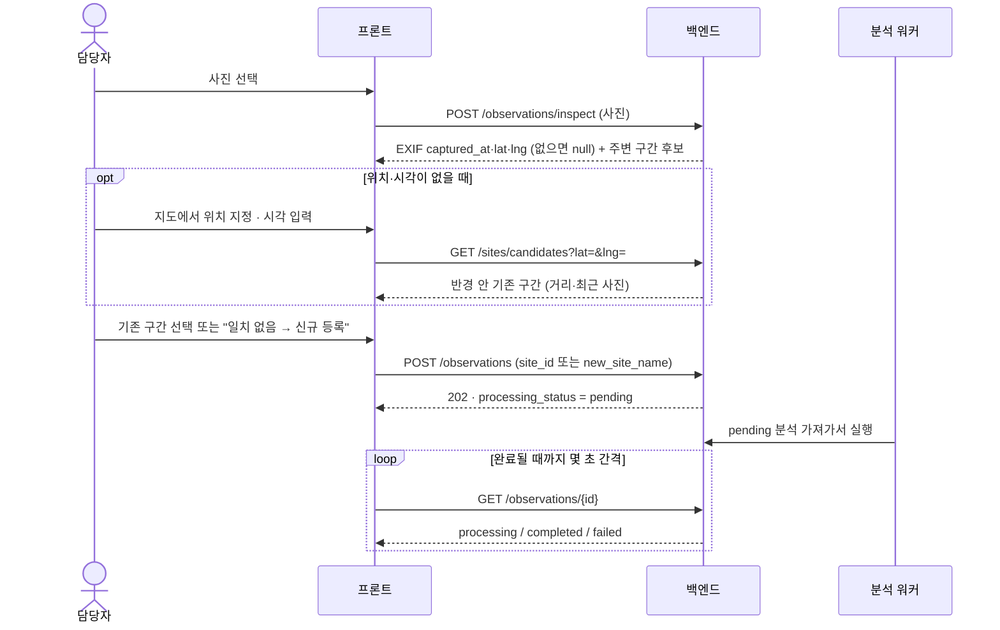
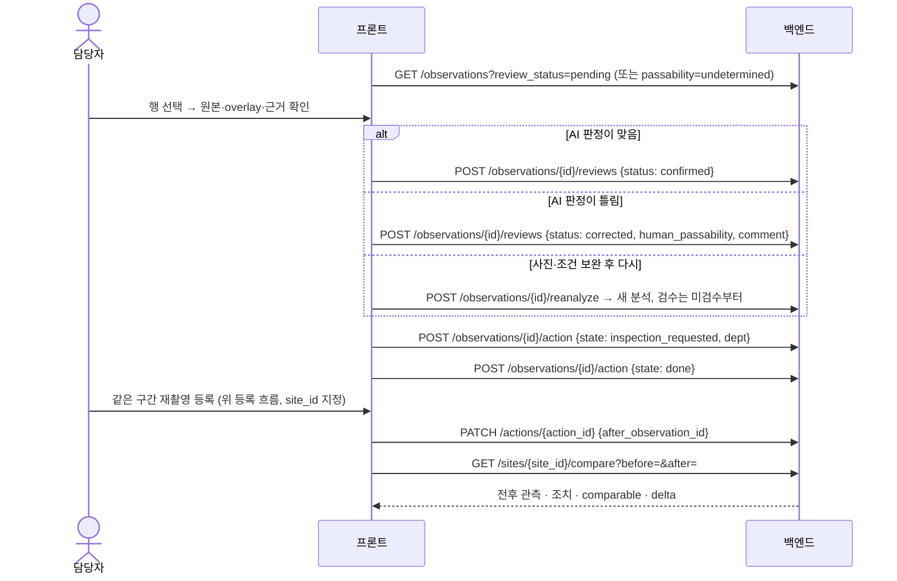

# RoadPush API (v1)

> 엔드포인트별 요청·응답·오류 코드 전체는 [specs/API_SPEC.md](specs/API_SPEC.md), 기능 목록은 [specs/FEATURE_SPEC.md](specs/FEATURE_SPEC.md).

기본 주소 `http://localhost:8000/api/v1` · 대화형 문서 `http://localhost:8000/docs`
프론트 `.env`: `VITE_API_BASE_URL=http://localhost:8000/api/v1`

응답의 앞부분은 **마스터 문서 4.4 공통 분석 응답 형식**과 이름·코드가 같습니다. 그 뒤에 화면용 필드를 덧붙였습니다.
처리 상태 · AI 판정 · 검수 상태는 하나로 합치지 않습니다.

## 엔드포인트

| 기능 | 메서드 · 경로 | 설명 |
|---|---|---|
| | `GET /health` | 상태·사용 모델·코드 버전 (`backend`·`ai`: `commit`·`dirty`, 각 저장소의 git에서 읽음)·분석 워커 (`worker`: `alive`·`pending`·`processing`·`last_error`) |
| F1 | `POST /observations/inspect` | 사진 EXIF의 촬영시각·GPS + (GPS가 있으면) 주변 구간 후보 |
| F1 | `GET /sites/candidates?lat=&lng=&radius_m=` | 검색 반경 안 기존 구간 후보 (최근 사진 썸네일 포함) |
| F1·F2 | `POST /observations` | 관측 등록 (multipart). **기존 구간(`site_id`) 또는 신규 구간(`new_site_name`) 필수**. 202 응답 후 비동기 분석 |
| F3 | `GET /map` | 구간별 최신 촬영 관측 + 필요 시 이전 참고 관측 |
| F4·F7 | `GET /observations` | 검수 표·목록. `processing_status`, `passability`, `review_status`, `site_id`, `source`, `since`, `until` |
| F4 | `GET /observations/{id}` | 상세 |
| F2 | `GET /observations/{id}/analyses` | 분석 이력 (자동 재시도 횟수, 사용자 재분석 구분, 근거 JSON, 처리 시간 `started_at`·`timings`) |
| F7·F2 | `POST /observations/{id}/reanalyze` | 새 재분석 요청 → 새 analysis (기존 결과·검수 보존) |
| F7·F2 | `POST /observations/{id}/reanalyze/cancel` | 시작 전(`pending`) 재분석 요청 취소 → 이전 분석 결과·검수로 돌아감 |
| F5 | `POST /observations/{id}/reviews` | 확인(의견) / 수정(사람 판정 + 이유). 분석 단위로 저장 |
| F5 | `POST /observations/{id}/reviews/cancel` | 확인·수정 취소 → 미검수 (이력은 남김) |
| | `POST /observations/{id}/notes` | 메모. 처리 상태·검수는 바꾸지 않고 `history`에 남음 |
| | `PATCH /observations/{id}/notes/{note_id}` | 메모 고치기 `{content}` → `edited_at` 기록. 다른 관측의 메모면 404 (지우기는 없음) |
| | `DELETE /observations/{id}` | 잘못 올린 관측 삭제(관리용, 되돌릴 수 없음) → 204. 분석·검수·메모·조치·사진 파일까지. 분석 중이면 409 |
| F5 | `POST /observations/{id}/action` | 처리 상태 변경 (이 관측을 '조치 전'으로 하는 조치를 만들거나 갱신) |
| F5 | `POST /observations/bulk-action` | 여러 관측 일괄 처리 |
| F5 | `POST /actions` · `PATCH /actions/{id}` | 조치 생성·갱신, **조치 후 관측 연결**(`after_observation_id`) |
| | `GET / POST /sites` · `GET / PATCH / DELETE /sites/{id}` | 구간. 삭제는 관측이 없을 때만 (있으면 409) |
| F6 | `GET /sites/{id}/observations` | 같은 구간 관측 촬영시각 순 (전후 선택용) |
| F6 | `GET /sites/{id}/actions` | 구간 조치 이력 |
| F6 | `GET /sites/{id}/compare?before=&after=` | 전후 비교 |
| | `GET /files/{key}` | 원본·overlay (응답 `images`에 전체 URL로 들어감) |

`GET /sites/candidates` 응답에는 `nearby_links`(성남 표준노드링크) 외에 `reference_walk_link`(서울 보행 링크 참조 레이어, 없으면 `null`)가 들어갑니다.
구간 응답(`SiteOut`)에는 `sidewalk_width_source`, `ref_walk_link_id`, `road_width_m`·`road_width_source`·`road_lanes`가 있습니다 (docs/DB.md 6장).
도로폭은 실폭(`ref_rw`)이 있으면 그것, 없으면 대표 도로폭(`ref_ngii` 등)입니다. `POST /sites`·`PATCH /sites/{id}`에 `road_width_m`을 주면 현장 값(`field`)으로 저장하고,
PATCH로 도로폭·차로 수를 바꾸면 그 구간 분석의 위험도를 다시 냅니다.

**위험도 기준** (프론트 설정 화면용. 식과 기본값은 [PASSABILITY.md 5장](PASSABILITY.md#5-상대-위험도-riskpy))

| 메서드·경로 | 설명 |
|---|---|
| `GET /risk-policy` | 현재 기준 `{version, params, defaults, terms, note, created_by, created_at}`. 저장한 기준이 없으면 `version: null` + 기본값 |
| `GET /risk-policy/history` | 저장한 기준 목록 (최신 먼저) |
| `PUT /risk-policy` | `{params, note, actor, apply_to_existing=true}` → 새 버전으로 저장, 완료된 분석 점수 재계산 (`recomputed` 건수). 잘못된 값은 422 |
| `POST /risk-policy/preview` | `{params}` → 저장하지 않고 관측별 지금 점수·등급과 바뀔 점수·등급, 등급 분포 |

`params`(`RiskParams`)의 각 항목 설명·범위는 `/docs` 스키마에 있습니다. 되돌리기는 `defaults`나 `history`의 `params`를 다시 `PUT`합니다.

**배포용 지도·CCTV 프록시** (`/api/v1` 밖, 프론트 개발 서버 프록시와 같은 경로. 문서 화면에는 안 나옴)

| 경로 | 키 (백엔드 `.env`) | 동작 |
|---|---|---|
| `GET /vworld/wmts/{레이어/z/y/x.png}` | `VWORLD_KEY`, `VWORLD_DOMAIN` | 브이월드 배경지도 타일. 등록한 서비스 URL을 Referer로 보냄 |
| `GET /api/utic/player?cctvid=` | `UTIC_API_KEY` | UTIC 재생 페이지로 302. 요청 간격 1.1초·카메라 정보 캐시. **UTIC에 등록한 IP의 서버에서만 동작** |
| `GET /api/its/cctvs` | `ITS_API_KEY` | 고속도로·국도 CCTV 위치 (6시간 캐시, 영상 주소·키 제외) |
| `GET /api/its/stream?type=&name=&lat=&lng=` | `ITS_API_KEY` | 카메라 주변을 다시 조회해 `{"hls": ...}` |

## 등록 흐름 (4.6 F1·F2)



## 검수·조치·전후 비교 흐름 (4.6 F5·F6·F7)



| 필드 | 필수 | 설명 |
|---|---|---|
| `file` | ✓ | jpg·jpeg·png·webp (영상 mp4·mov·avi·mkv는 선택 기능) |
| `captured_at` | ✓ | ISO 8601 **시간대 포함**. 저장은 UTC, 응답은 +09:00 |
| `captured_at_source` | | `exif` · `manual` · `device` |
| `lat`, `lng` | | 촬영 좌표. 없으면 저장은 하되 신규 구간은 만들 수 없음 |
| `location_source` | | `exif` · `manual` · `device` (지도에서 고친 위치의 출처) |
| `site_id` | △ | 후보에서 확인한 기존 구간 |
| `new_site_name`, `new_site_description` | △ | 일치하는 후보가 없을 때 신규 구간 |
| `source` | | `upload`(기본) · `cctv` · `car` · `drone` |
| `device` | | |
| `area`, `addr` | | 비우면 분석 워커가 브이월드 역지오코딩으로 채움 (`VWORLD_KEY` 필요). area = `분당구 이매동`(시군구 + 법정동), addr = 지번 주소 + `(행정동 …)` |
| `mask` | | 개발용: 미리 만든 통합 라벨 PNG(값 0~7) |

오류: 형식 아님 415 · 손상 이미지·시간대 없음·구간 미확인 422 (관측을 만들지 않음).

## 관측 응답 (`ObservationOut`)

```jsonc
{
  // ── 마스터 문서 4.4 ──
  "observation_id": "obs_8500215a8e0a",
  "analysis_id": "ana_5efdfba9f5a7",
  "site_id": "site_1f0c2b7d9a11",
  "location": { "latitude": 37.3868, "longitude": 127.1273 },   // 구간 대표 위치 (같은 구간 관측은 같은 좌표 → 프론트가 한 지점으로 묶음)
  "captured_at": "2026-10-20T14:30:00+09:00",
  "processing_status": "completed",          // pending | processing | completed | failed
  "passability": "narrowed",                 // passable | narrowed | blocked | undetermined, 처리중·실패면 null
  "risk_score": 55,                          // 산출 불가면 null (0으로 쓰지 않음)
  "uncertainty_reason": null,                // 판단 유보 사유
  "images": {
    "original": "http://…/files/observations/obs_…/original.jpg",
    "surface_overlay": "http://…/files/analyses/ana_…/surface_overlay.jpg",     // 보도·차도·연석·장애물 색칠
    "obstacle_overlay": "http://…/files/analyses/ana_…/obstacle_overlay.jpg"    // 점유(빨강)·남은 연속 통로(초록)·가장 좁은 단면(노랑)
  },
  "review_status": "pending",                // pending(미검수) | confirmed(확인) | corrected(수정) — 최신 분석 기준
  "human_passability": null,                 // corrected일 때 사람 판정
  "human_causes": null,                      // corrected일 때 사람이 고친 원인 (null이면 causes(AI)를 씀, []는 원인 없음)
  // ── 추가 ──
  "site_name": "서현로 18길", "link_id": "2060113500",
  "source": "upload", "device": null,
  "created_at": "2026-10-20T14:31:05+09:00",   // 백엔드에 등록된 시각 (captured_at은 사진 촬영 시각)
  "capture_location": { "latitude": 37.38683, "longitude": 127.12735 },  // 사진 촬영 좌표, 없으면 null
  "location_source": "exif",                 // capture_location의 출처
  "area": "분당구 이매동", "addr": "경기도 성남시 분당구 이매동 129-1 (행정동 이매1동)",  // 비어 있으면 자동 채움
  "occupancy": 45,                           // 가장 좁은 단면의 점유율(%)
  "bottleneck_ratio": 0.55,                  // 상대 유효폭 = 남은 연속 통로 / 추정 전체 보행폭
  "bottleneck_m_est": 1.32,                  // 구간 실측 보도폭이 있을 때만 (판정에는 안 씀)
  "risk_complete": false,                    // false = 측정 못 한 항(길이 등)을 빼고 낸 '부분 상대 지표'
  "risk_grade": "medium", "risk_grade_label": "보통",  // 위험도 기준의 등급 (기본 high 높음 · medium 보통 · low 낮음)
  "risk_policy_version": null,               // 점수를 낸 기준 버전 (null = 기본 기준)
  "causes": ["차량"],                         // 차량·공사시설·적치물·PM (시각 클래스 4개. 상태를 단정하지 않음)
  "uncertainty_code": null,                  // roadpush_ai: surface_uncertain | boundary_review | boundary_failed | occupancy_unverified | low_coverage | night
                                             // dummy: occluded | mixed | low_coverage | low_confidence | night  (PASSABILITY.md)
  "provisional": null,                       // boundary_review일 때만 검토용 추정 {passability, bottleneck_ratio, occupancy}
                                             // 확정 판정 아님: '추정 (사람 확인 필요)'로만 보이고 지도 색·집계에 쓰지 않는다
  "confidence": null,                        // roadpush_ai는 null (등급은 GET …/analyses의 evidence.stats.measurement_confidence). dummy는 0~1
  "reasons": ["남은 연속 통로가 가장 좁은 곳에서 보도 폭의 55% (상대폭 기준: 통과 ≥ 60%, 단절 < 30%) · 보도 실폭 기준 약 1.32m"],
  "analysis_trigger": "initial",             // initial | reanalysis
  "attempts": 1,
  "failure_reason": null,                    // failed일 때 한 줄 사유
  "review": null,                            // { id, analysis_id, status, human_passability, human_causes, comment, reviewer, created_at }
  "action": { "action_id": null, "state": "none", "label": "미처리", "dept": null },
  "history": [{ "t": "2026-10-21T11:56:14+09:00", "txt": "AI 분석 완료 · 좁아짐 (상대 위험도 55)", "ai": true, "by": null }],
  "model_version": "mask2former_mapillary_swin_large@cpu + yolo11n-seg + obstacle_v2_yolo11s_full_os4",
  "rule_version": "phase7_b_result_v2/phase7-consumer-2026.10"   // dummy: rules-2026.10-b/policy-2026.10-draft
}
```

## 지도 (`GET /map`)

```jsonc
[{
  "site_id": "site_…", "site_name": "서현로 18길",
  "location": { "latitude": 37.38, "longitude": 127.12 },     // 구간 대표 위치
  "latest": { /* ObservationOut: 촬영시각이 가장 늦은 관측 */ },
  "reference": null,            // latest가 pending·processing·failed일 때만 이전 완료 관측
  "effective_passability": "blocked",   // 지도 색: 관리자 판정 > AI 판정
  "effective_source": "human"           // 출처 표시용
}]
```

- 최신은 **촬영시각** 기준입니다. 늦게 올린 옛 사진은 최신이 아닙니다.
- 최신이 판단 유보로 완료되면 그대로 유보입니다. 이전 정상 판정으로 숨기지 않습니다.
- 새 관측에는 이전 관측의 사람 판단을 적용하지 않습니다.
- `south`·`west`·`north`·`east`로 지도 범위를 거를 수 있습니다.

## 검수·재분석·조치

```jsonc
// POST /observations/{id}/reviews     (analysis_id 생략 = 최신 완료 분석)
{ "status": "confirmed", "comment": "현장 사진과 일치", "reviewer": "교통행정과" }
{ "status": "corrected", "human_passability": "blocked", "comment": "차량 뒤쪽 보도까지 막힘", "reviewer": "교통행정과" }
// 원인도 고칠 때 (선택, corrected에서만): 차량 | 공사시설 | 적치물 | PM. 생략하면 AI 원인 그대로, []는 원인 없음
{ "status": "corrected", "human_passability": "blocked", "human_causes": ["차량", "적치물"], "reviewer": "교통행정과" }

// POST /observations/{id}/reviews/cancel   (body 생략 가능. 검수가 없거나 이미 취소면 409)
{ "comment": "판정 실수", "reviewer": "교통행정과" }

// POST /observations/{id}/reanalyze
{ "note": "밝기 보정한 사진으로 다시" }

// POST /observations/{id}/reanalyze/cancel   (body 없음)
// 재분석이 pending일 때만. 처음 분석·이미 시작한 분석(processing)·대기 중 재분석이 없으면 409

// POST /observations/{id}/notes   → 201
{ "content": "운영사 수거 요청 접수번호 1234", "author": "교통행정과" }

// PATCH /observations/{id}/notes/{note_id}   → 200, 관측 전체 (내용이 같으면 edited_at은 그대로)
{ "content": "운영사 수거 요청 접수번호 1235" }
// history의 메모 항목 (다른 항목은 id·content·author·created_at·edited_at이 null)
{ "t": "2026-10-21T12:03:00+09:00", "txt": "메모: 운영사 수거 요청 접수번호 1235", "ai": false, "by": "교통행정과",
  "id": "note_…", "content": "운영사 수거 요청 접수번호 1235", "author": "교통행정과",
  "created_at": "2026-10-21T12:03:00+09:00", "edited_at": "2026-10-21T15:40:12+09:00" }   // 수정 안 했으면 null → "(수정됨)" 표시 기준

// POST /observations/{id}/action    state: none | inspection_requested | in_progress | done
{ "state": "inspection_requested", "dept": "주차관리과", "content": "차량 이동 요청", "actor": "교통행정과" }

// PATCH /actions/{action_id}        재촬영 후 '조치 후 관측' 연결
{ "after_observation_id": "obs_…", "state": "done", "note": "재촬영 확인" }
```

## 전후 비교 (`GET /sites/{id}/compare?before=&after=`)

```jsonc
{
  "site_id": "site_…",
  "before": { /* ObservationOut */ }, "after": { /* ObservationOut */ },
  "actions": [{ "id": "act_…", "state": "done", "label": "조치 완료", "before_observation_id": "…", "after_observation_id": "…", "logs": [ … ] }],
  "comparable": true,
  "note": "같은 모델·규칙 기준. 촬영 위치·방향이 같은지는 사진으로 확인하세요",
  "delta": { "passability": ["blocked", "passable"], "risk_score": -62, "bottleneck_ratio": 0.71 }
}
```
모델·규칙 버전이 다르면 `comparable=false`, `delta=null` → 사진·상태만 비교하거나 같은 기준으로 재분석합니다.
위험도 감소를 실제 사고 감소로 표현하지 않습니다.

## 프론트 타입 매핑 (프론트 담당 참고)

| 프론트 `Observation` | API | 비고 |
|---|---|---|
| `id` | `observation_id` | |
| `src` | `source` | `upload`는 프론트 `Source`에 없음 → 타입 추가 필요 |
| `dev` | `device` | |
| `lat`, `lng` | `location.latitude/longitude` | 구간 대표 위치. 사진 좌표는 `capture_location` |
| `area`, `addr` | `area`, `addr` | 비어 있으면 백엔드가 역지오코딩으로 채움 (프론트 `npm run geocode`와 같은 형식) |
| `t` | `captured_at` | 사진 촬영 시각. 등록 시각은 `created_at` |
| `pass` | `passability` | `undetermined` ↔ `hold`, 처리 전·실패는 null → 별도 표시 |
| `risk` | `risk_score` | "상대 위험도"로 표시 권장 (`risk_complete=false`) |
| `occ` | `occupancy` | |
| `causes` | `causes` | 프론트 `ROUTES` 키와 같은 이름 (vehicle→차량, construction→공사시설, debris→적치물, micromobility→PM) |
| `reason` | `uncertainty_reason` | |
| `cond` | `uncertainty_code` | |
| `action`, `dept` | `action.label`, `action.dept` | dept null → `미배정` |
| `seg` | `site_id` (지도 링크는 `link_id`) | |
| `human` | `human_passability` | 백엔드는 `undetermined`(사람도 판단 유보)도 허용 → 프론트 타입에 추가 필요 |
| `review` | `review_status` | pending→`미검수`, confirmed→`확인`, corrected→`수정` |
| `reanalyze` | `processing_status in (pending, processing)` | |
| `hist` | `history` | |
| (없음) | `processing_status` | **처리중·실패 표시가 프론트에 필요** (4.3) |
