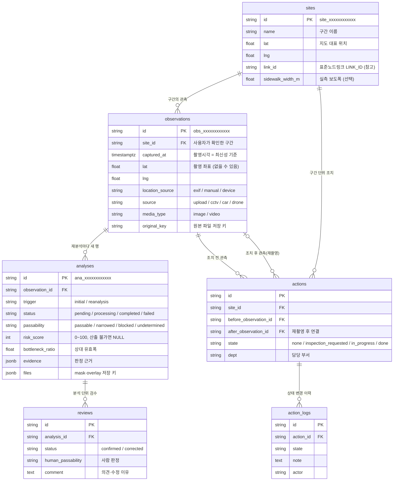
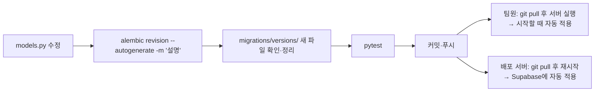

# DB 설계와 Supabase 연결

## 1. Supabase(PostgreSQL)를 써도 되는가 → 써도 됩니다

| 확인 항목 | 판단 |
|---|---|
| 마스터 문서 원칙 "프론트는 DB에 직접 연결하지 않음" | 지킬 수 있음. Supabase를 **PostgreSQL 서버로만** 쓰고, 프론트는 백엔드 API만 부릅니다. supabase-js·anon 키를 프론트에 넣지 않습니다 |
| 코드 변경량 | 거의 없음. `.env`의 `DATABASE_URL`만 바꾸면 됩니다. 같은 테스트를 로컬 PostgreSQL 16에서 돌려 통과를 확인했습니다 |
| 테스트 URL 배포 (심사 기간 11월 중순까지) | 오히려 유리. 백엔드 서버를 옮기거나 재시작해도 데이터가 남습니다 |
| 팀 공유 | 여러 명이 같은 데이터를 볼 수 있음. 단, 아래 "주의 2" 필수 |
| 비용 | 무료 플랜(DB 500MB)으로 충분. 관측·분석 메타데이터만 들어가고 사진은 DB에 넣지 않습니다 |

**주의할 점 (설정에 반영해 둠)**

1. **외부 노출 차단**: Supabase는 `public` 스키마 테이블을 anon 키로 REST(Data API)에 자동 노출합니다.
   첫 마이그레이션이 모든 테이블에 **RLS(Row Level Security)를 켜고 정책을 두지 않아** 외부 접근을 막습니다.
   백엔드는 `postgres` 역할로 접속해 영향을 받지 않습니다. 대시보드에서 정책을 추가하지 마세요.
2. **DB와 사진 저장소는 같이 다녀야 합니다**: DB에는 사진의 "저장 키"만 있고, 실제 파일은 그 서버의 `storage/` 폴더에 있습니다.
   팀원 여러 명이 각자 PC에서 **같은 Supabase DB**에 붙으면, A가 올린 사진은 B의 PC에 없어서 이미지가 깨집니다.
   → **팀원 로컬 개발은 각자 SQLite(기본값)**, **Supabase는 배포 서버 1대만** 연결합니다.
   팀원들이 같은 데이터를 봐야 하면 배포 서버의 API 주소를 쓰면 됩니다. (나중에 사진도 Supabase Storage로 옮기면 이 제약이 사라집니다)
3. **연결 주소는 Session pooler**: Direct connection(`db.<ref>.supabase.co`)은 기본적으로 IPv6로만 열려 있어 IPv6가 안 되는 네트워크·서버에서는 안 붙습니다.
   대시보드 **Connect → Session pooler** 주소(포트 5432)를 쓰세요. Transaction pooler(6543)도 동작하도록 설정해 두었습니다.
4. **무료 플랜 일시정지**: 무료 플랜 프로젝트는 일정 기간(현재 약 1주) 활동이 없으면 일시정지될 수 있습니다.
   배포 서버가 켜져 있으면 워커가 계속 DB를 조회하지만, 정확한 기준은 Supabase 요금 안내에서 확인하고
   **심사 기간(11월 중순까지) 중 주기적으로 대시보드 상태를 확인**하세요. 일시정지되면 대시보드에서 복구(Restore)할 수 있습니다.

## 2. Supabase 연결 순서

1. [supabase.com](https://supabase.com) → New project
   - Region: **Northeast Asia (Seoul)**
   - Database password: 영문·숫자로 길게 (특수문자를 쓰면 주소에 넣을 때 URL 인코딩 필요). 팀 비밀번호 관리 도구에만 저장
2. 프로젝트 화면 상단 **Connect** → **Session pooler** 주소 복사 (호스트 이름은 대시보드에 나온 그대로 씁니다)
   ```
   postgresql://postgres.<프로젝트ref>:[YOUR-PASSWORD]@<pooler 호스트>.pooler.supabase.com:5432/postgres
   ```
3. 앞부분을 `postgresql+psycopg://`로 바꾸고 끝에 `?sslmode=require`를 붙여 **배포 서버의** `.env`에 넣습니다
   ```
   DATABASE_URL=postgresql+psycopg://postgres.<ref>:<비밀번호>@<pooler 호스트>.pooler.supabase.com:5432/postgres?sslmode=require
   ```
4. 백엔드를 실행하면 시작할 때 테이블이 자동으로 만들어집니다 (마이그레이션 적용). 직접 적용하려면 `alembic upgrade head`
5. Supabase 대시보드 **Table Editor**에서 6개 테이블과 `alembic_version`이 보이면 완료. 각 테이블에 "RLS enabled" 표시가 있어야 합니다

`.env`는 Git에 올라가지 않습니다. 비밀번호를 메신저·문서·코드에 붙여 넣지 마세요.

## 3. 테이블 관계



## 4. 테이블 정의

원본 정의는 `app/db/models.py`, 실제 DB에 적용되는 변경 이력은 `migrations/versions/`입니다. 모든 시각은 `timestamptz`(UTC 저장).

### sites — 구간
| 열 | 형식 | NULL | 설명 |
|---|---|---|---|
| id | varchar(32) PK | | `site_` + 12자리 |
| name | varchar(200) | | 구간 이름 |
| description | text | ✓ | |
| lat, lng | float | | 지도 대표 위치 |
| link_id | varchar(20) | ✓ | 국토교통부 표준노드링크 LINK_ID. 참고용이며 구간 확정을 대신하지 않음 |
| sidewalk_width_m | float | ✓ | 현장 실측 보도폭(m). 있으면 추정 절대폭을 덧붙임 |
| created_at | timestamptz | | |

### observations — 관측 (사진 1장 + 위치·시각 + 확정 구간)
| 열 | 형식 | NULL | 설명 |
|---|---|---|---|
| id | varchar(32) PK | | `obs_` + 12자리 |
| site_id | FK → sites | | 사용자가 확인한 구간 |
| source | varchar(16) | | `upload` · `cctv` · `car` · `drone` |
| device | varchar(64) | ✓ | |
| lat, lng | float | ✓ | 촬영자 좌표. 장애물 위치와 다를 수 있음 |
| location_source | varchar(16) | ✓ | `exif` · `manual` · `device` |
| captured_at | timestamptz | | **촬영시각 = 최신성 기준** |
| captured_at_source | varchar(16) | | `exif` · `manual` · `device` |
| area, addr | varchar | ✓ | 행정구역·주소 |
| media_type | varchar(8) | | `image` · `video` (CHECK) |
| original_key | varchar(300) | | 원본 파일 저장 키 |
| created_at | timestamptz | | 등록 시각 (최신성 판단에 안 씀) |

인덱스: `(site_id, captured_at)` — 구간별 최신 촬영 관측

### analyses — AI 분석 1회 (재분석은 새 행, 작업 큐 겸용)
| 열 | 형식 | NULL | 설명 |
|---|---|---|---|
| id | varchar(32) PK | | `ana_` + 12자리 |
| observation_id | FK → observations | | |
| trigger | varchar(16) | | `initial` · `reanalysis` (CHECK) |
| reanalysis_note | text | ✓ | 재분석 때 무엇을 보완했는지 |
| status | varchar(16) | | `pending` · `processing` · `completed` · `failed` (CHECK, 4.4) |
| attempts | int | | 자동 재시도 포함 실행 횟수 |
| error, error_kind | text, varchar | ✓ | `input`(재시도 안 함) · `runtime` · `exhausted` |
| model_version, rule_version | varchar | ✓ | 같은 기준끼리만 전후 지표 비교 |
| passability | varchar(16) | ✓ | `passable` · `narrowed` · `blocked` · `undetermined` (CHECK) |
| risk_score | int | ✓ | 0~100 (CHECK). 산출 불가면 NULL |
| occupancy | int | ✓ | 가장 좁은 단면 점유율(%) |
| bottleneck_ratio | float | ✓ | 상대 유효폭 |
| bottleneck_m_est | float | ✓ | 상대폭 × 실측 보도폭 |
| confidence | float | ✓ | |
| uncertainty_code, uncertainty_reason | varchar, text | ✓ | 판단 유보 사유 |
| causes | jsonb | | 원인 배지 목록 |
| evidence | jsonb | | 근거 문장·통계·위험도 식·화질 |
| files | jsonb | | `{class_map, surface_overlay, obstacle_overlay}` 저장 키 |
| created_at, finished_at | timestamptz | | |

### reviews — 관리자 확인·수정 (분석에 붙음, 새 분석에 승계 안 됨)
| 열 | 형식 | NULL | 설명 |
|---|---|---|---|
| id | varchar(32) PK | | |
| analysis_id | FK → analyses | | |
| status | varchar(16) | | `confirmed` · `corrected` (CHECK) |
| human_passability | varchar(16) | ✓ | 수정한 사람 판정 (CHECK) |
| comment | text | ✓ | 확인 의견 또는 수정 이유 |
| reviewer | varchar(64) | ✓ | |
| created_at | timestamptz | | 최신 행이 현재 검수 상태 |

### actions — 현장조치 (구간 단위, 전후 관측 연결)
| 열 | 형식 | NULL | 설명 |
|---|---|---|---|
| id | varchar(32) PK | | |
| site_id | FK → sites | | |
| before_observation_id | FK → observations | | 조치 전 관측 |
| after_observation_id | FK → observations | ✓ | 재촬영 후 관측 |
| state | varchar(24) | | `none` · `inspection_requested` · `in_progress` · `done` (CHECK) |
| dept | varchar(64) | ✓ | 담당 부서 |
| content | text | ✓ | 조치 내용 |
| created_at, updated_at | timestamptz | | |

### action_logs — 조치 변경 이력
| 열 | 형식 | NULL | 설명 |
|---|---|---|---|
| id | varchar(32) PK | | |
| action_id | FK → actions | | |
| state, dept, note, actor | | ✓ | 바뀐 상태·부서·메모·담당자 |
| created_at | timestamptz | | |

### 지금 없는 것 (필요해지면 추가)
- 담당자 계정·권한 (마스터 문서: 임의 확정하지 않음)
- 별도 파일 참조 테이블 (지금은 `original_key`, `analyses.files`에 저장 키)
- 위험정보 유효시간, PostGIS 공간 인덱스 (전국 확장 때)

## 5. 스키마를 바꿀 때

테이블 정의(`app/db/models.py`)와 실제 DB가 어긋나지 않도록 **Alembic 마이그레이션**으로만 바꿉니다.
Supabase 대시보드에서 직접 열을 추가·수정하지 마세요 (다음 마이그레이션과 꼬입니다).



```bash
alembic revision --autogenerate -m "sites에 담당 부서 추가"   # 새 마이그레이션 파일 생성
alembic upgrade head                                          # 적용 (서버 시작 때도 자동 적용)
alembic check                                                 # models.py와 DB가 같은지 확인
alembic upgrade head --sql                                    # DB에 붙지 않고 SQL만 출력 (검토용)
```

- 자동 생성 파일은 꼭 열어 확인합니다 (이름 변경을 "삭제 + 추가"로 인식하는 등).
- 이미 푸시한 마이그레이션 파일은 고치지 말고 새 파일을 추가합니다.
- 두 사람이 동시에 마이그레이션을 만들면 순서가 갈라집니다. **스키마 변경은 백엔드 담당 한 명이 맡는 것**을 권합니다.
