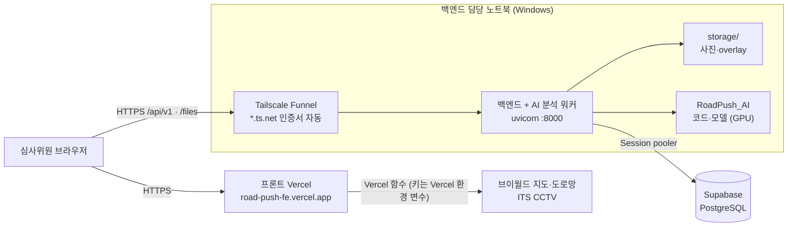

# 테스트 URL 배포

심사위원이 여는 주소는 프론트(Vercel, HTTPS)입니다. 백엔드와 AI 분석은 **백엔드 담당 노트북**에서 돌고,
**Tailscale Funnel**이 고정 HTTPS 주소로 인터넷에 열어 줍니다. 데이터는 Supabase에 있습니다.

| 항목 | 값 |
|---|---|
| 프론트 | https://road-push-fe.vercel.app |
| 백엔드 공개 주소 | https://desktop-han01.tail5a740d.ts.net (`/api/v1`, `/files`) |
| DB | Supabase PostgreSQL (서울, Session pooler) |
| 사진·overlay | 노트북 `RoadPush_BE/storage/` |

## 1. 구성



| 역할 | 맡는 곳 |
|---|---|
| 화면, 브이월드 배경지도(`/vworld/wmts`), 도로망(`/api/roads`), ITS CCTV(`/api/its/*`) | 프론트 Vercel 함수 (`api/`) |
| 관측·분석·검수·조치 API(`/api/v1`), 사진·overlay(`/files`), AI 분석 | 이 백엔드 (노트북) |

- AI는 별도 서버가 아닙니다. 백엔드가 `ROADPUSH_AI_ROOT`(`../RoadPush_AI`)의 코드와 모델을 직접 불러 분석합니다.
- 사진 원본·모델·분석 연산은 노트북(국내)에 있고, DB는 Supabase 서울 리전에 있습니다.
- 백엔드에도 `/vworld/wmts`, `/api/its/*` 프록시가 있지만 Vercel 함수가 같은 일을 하므로 배포에서는 쓰지 않습니다.

## 2. 처음 설정

### ① 백엔드·AI 설치
[SETUP.md](SETUP.md) 4장(실제 모델, `.venv312`)대로 백엔드와 RoadPush_AI를 설치하고 모델을 `RoadPush_AI/models/`에 넣습니다.

### ② `.env`
```
DATABASE_URL=postgresql+psycopg://postgres.<ref>:<비밀번호>@aws-0-ap-northeast-2.pooler.supabase.com:5432/postgres?sslmode=require
PUBLIC_BASE_URL=https://desktop-han01.tail5a740d.ts.net
ANALYSIS_ENGINE=roadpush_ai
ROADPUSH_AI_ROOT=../RoadPush_AI
VWORLD_KEY=<브이월드 키>
VWORLD_DOMAIN=https://road-push-fe.vercel.app
```
- `PUBLIC_BASE_URL`: 응답의 사진·overlay 주소 앞부분. 비우면 `http://`로 나가 HTTPS 화면에서 이미지가 막힙니다.
- 비밀번호·키가 든 `.env`는 노트북에만 둡니다 (Git 제외).
- 이 노트북에서 백엔드로 하는 작업은 모두 배포 데이터(Supabase)에 반영됩니다. 로컬 SQLite로 개발할 때는
  `DATABASE_URL`을 `sqlite:///./data/roadpush.db`로 바꾸고, 배포 중에는 되돌려 둡니다.

### ③ Tailscale Funnel
1. https://tailscale.com/download 에서 Windows 앱 설치 → 로그인 (Personal 플랜)
2. 공개 주소 열기 (처음 한 번 Funnel 허용 링크가 나오면 브라우저에서 승인):
   ```powershell
   & "C:\Program Files\Tailscale\tailscale.exe" funnel --bg 8000
   & "C:\Program Files\Tailscale\tailscale.exe" funnel status     # https://desktop-han01.tail5a740d.ts.net
   ```
3. `--bg` 설정은 Tailscale에 저장되어 재부팅 후에도 유지됩니다. **Tailscale 트레이 앱이 켜져 있어야** 공개 주소가 열립니다.
4. 끄기: `tailscale funnel --https=443 off`

### ④ 백엔드 실행
```powershell
cd C:\dev\RoadPush_BE
.venv312\Scripts\python -m uvicorn app.main:app --port 8000
```
- 서버가 시작될 때 DB 마이그레이션을 최신까지 적용합니다 (Supabase에도 자동).
- `--reload`는 쓰지 않습니다. 파일이 바뀌면 재시작되면서 진행 중인 분석이 끊깁니다.
- 이 창을 닫으면 백엔드가 꺼집니다. 심사 기간에는 창을 켜 둡니다.

### ⑤ 프론트(Vercel) 연결 — 프론트 담당
Vercel 환경 변수 `VITE_API_BASE_URL=https://desktop-han01.tail5a740d.ts.net/api/v1` → **Redeploy** (빌드 때 들어가는 값).
주소가 고정이라 한 번만 하면 됩니다.

### ⑥ 노트북 전원
- 전원 연결, 절전 "안 함", 덮개를 닫을 때 "아무 것도 안 함" (설정 → 시스템 → 전원)
- Windows 업데이트 자동 재시작을 심사 기간 동안 일시 중지

## 3. 다시 배포할 때 (코드가 바뀌었을 때)

공개 주소·Tailscale·Vercel은 그대로 두고, **노트북의 백엔드만 새 코드로 다시 띄웁니다.**

1. 백엔드 창에서 `Ctrl+C`로 끕니다. 분석 중인 사진이 있으면 끝난 뒤에 끕니다 (끊긴 분석은 다음 시작 때 다시 대기열에 들어갑니다).
2. 새 코드를 받습니다.
   ```powershell
   cd C:\dev\RoadPush_BE
   git pull
   git -C ..\RoadPush_AI pull          # AI 코드가 바뀌었을 때
   ```
3. 의존성이 바뀌었으면(`pyproject.toml` 변경) 다시 설치합니다. 바뀌지 않았으면 건너뜁니다.
   ```powershell
   .venv312\Scripts\python -m pip install -e ".[ai,dev]"
   ```
   AI 모델 파일이 바뀌었으면 `RoadPush_AI/models/`를 새 파일로 바꿉니다 (Git에 없음).
4. 다시 실행합니다. DB 구조가 바뀌었으면 시작할 때 Supabase에 자동으로 적용됩니다.
   ```powershell
   .venv312\Scripts\python -m uvicorn app.main:app --port 8000
   ```
5. 확인: https://desktop-han01.tail5a740d.ts.net/api/v1/health 의 `backend.commit`·`ai.commit`이 방금 받은 커밋과 같은지 봅니다.
   ```json
   {"status": "ok", "analysis_engine": "roadpush_ai",
    "backend": {"commit": "…", "dirty": false},
    "ai": {"commit": "…", "dirty": false}}
   ```

프론트 코드가 바뀐 경우는 Vercel이 프론트 저장소 push로 자동 배포하므로 백엔드에서 할 일이 없습니다.

## 4. 확인 목록

- [ ] https://desktop-han01.tail5a740d.ts.net/api/v1/health 가 열림, `analysis_engine`이 `roadpush_ai`
- [ ] Vercel 화면 상단에 "백엔드 연결 실패"가 없음, 관측 목록이 백엔드 데이터
- [ ] 상세 화면의 사진·overlay가 보임 (주소가 `https://…ts.net/files/…`)
- [ ] 처리 상태·검수·메모를 바꾸고 새로고침해도 유지
- [ ] 사진 1장을 등록하면 "분석 대기"에서 결과로 바뀜
- [ ] 휴대폰(다른 네트워크)에서도 열림

## 5. 주의

- **노트북이 꺼지거나 잠들면 서비스가 멈춥니다.** 백엔드 창과 Tailscale 트레이 앱이 켜져 있는지 확인합니다.
- Supabase 무료 플랜은 오래 쓰지 않으면 일시정지될 수 있어 심사 기간 중 대시보드를 확인합니다 ([DB.md 1장](DB.md)).
- `/api/v1`은 로그인이 없습니다. 주소를 아는 사람은 데이터를 바꿀 수 있으므로 심사용 시연 데이터만 넣습니다.
- 공개 URL로 YOLO(Ultralytics)를 서비스하면 AGPL 조건이 적용됩니다. 성과보고서에 사용 모델과 라이선스를 적습니다.
- 공개 시연 데이터에는 이용 조건이 확인된 사진만 둡니다 (AI Hub 원본 사진은 넣지 않음, 얼굴·번호판 비식별).
- 심사가 끝나면 `tailscale funnel --https=443 off`로 공개 주소를 닫습니다.
