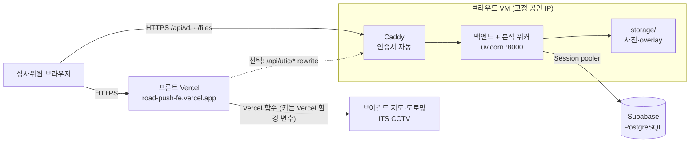

# 테스트 URL 배포

심사위원이 여는 주소는 프론트(Vercel, HTTPS)입니다. 프론트가 부르는 백엔드도 **HTTPS**여야 합니다
(HTTPS 페이지에서 HTTP API·이미지를 부르면 브라우저가 막습니다).

## 1. 구성



| 역할 | 맡는 곳 |
|---|---|
| 화면, 브이월드 배경지도(`/vworld/wmts`), 도로망(`/api/roads`), ITS CCTV(`/api/its/*`) | 프론트 Vercel 함수 (`api/`) |
| 관측·분석·검수·조치 API(`/api/v1`), 사진·overlay(`/files`) | 이 백엔드 |
| UTIC CCTV 재생(`/api/utic/player`) | 선택. UTIC는 등록 IP에서만 응답하므로 고정 IP가 있는 이 백엔드만 가능 |

백엔드에도 `/vworld/wmts`, `/api/its/*` 프록시가 있지만 Vercel 함수가 같은 일을 하므로 배포에서는 쓰지 않아도 됩니다.

## 2. VM 고르기

| 조건 | 이유 |
|---|---|
| 11월 중순(심사 종료)까지 계속 켜져 있음 | 노트북·무료 호스팅의 잠자기 모드는 안 됨 |
| 메모리 2GB 이상 (모델 2개 CPU 추론 시 4GB 이상 권장) | torch + DeepLab + YOLO |
| 고정 공인 IP | HTTPS 도메인 연결, UTIC 등록 IP |
| 서울·춘천 지역 | Supabase·Vercel(icn1)과 가깝고 UTIC 등록에 유리 |

추천 순서: **Oracle Cloud 상시 무료**(ARM A1, Ubuntu 24.04) → 자리가 없으면 AMD 소형(1GB, 스왑 필요) → AWS 크레딧.
가입 때 무료 한도와 고정 IP 조건을 확인하고, 카드 등록 시 예산 알림을 걸어 둡니다.

## 3. 설치 순서 (Ubuntu 24.04, `ubuntu` 계정 기준)

### ① 포트 열기
- 클라우드 콘솔의 보안 규칙(Oracle: VCN → Security List)에서 **TCP 80, 443** 인바운드 허용 (22는 기본)
- Oracle Ubuntu 이미지는 OS 방화벽도 막혀 있어 한 번 더 엽니다:
```bash
sudo iptables -I INPUT 6 -m state --state NEW -p tcp --dport 80 -j ACCEPT
sudo iptables -I INPUT 6 -m state --state NEW -p tcp --dport 443 -j ACCEPT
sudo netfilter-persistent save
```

### ② 도메인
VM 공인 IP가 `1.2.3.4`라면 **`1-2-3-4.sslip.io`** 를 그대로 씁니다 (가입 없이 그 IP로 연결되는 무료 도메인).
이름을 고정하고 싶으면 DuckDNS 같은 무료 DNS에서 이름을 만들어 IP를 연결합니다.

### ③ 백엔드
```bash
sudo apt update && sudo apt install -y python3-venv python3-pip git
git clone https://github.com/KingHaKyung/RoadPush_BE.git && cd RoadPush_BE
python3 -m venv .venv && . .venv/bin/activate
pip install -U pip
pip install torch torchvision --index-url https://download.pytorch.org/whl/cpu   # 실제 모델을 쓸 때 (CPU)
pip install -e ".[ml]"                                                            # 모델 없이 dummy면 pip install -e .
cp .env.example .env && nano .env
```
`.env`에서 바꿀 값:
```
DATABASE_URL=postgresql+psycopg://postgres.<ref>:<비밀번호>@<pooler 호스트>.pooler.supabase.com:5432/postgres?sslmode=require
PUBLIC_BASE_URL=https://1-2-3-4.sslip.io
DEVICE=cpu
SURFACE_MODEL=selectstar            # 가중치 전에는 dummy (심사용 결과로 쓰지 않음)
SURFACE_WEIGHTS=model_weights/<모델 팀 노면 가중치>
OBSTACLE_MODEL=yolo
OBSTACLE_WEIGHTS=["model_weights/<모델 팀 장애물 가중치>.pt"]
VWORLD_KEY=<브이월드 키>             # 행정구역·주소 자동 채우기
VWORLD_DOMAIN=https://road-push-fe.vercel.app
UTIC_API_KEY=<선택: UTIC 재생을 백엔드로 할 때>
```
가중치 파일은 git에 없으므로 `scp`로 `model_weights/`에 올리고, 넣기 전에 `python scripts/check_model.py <사진>`으로 점검합니다.
비밀번호·키가 든 `.env`는 VM에만 둡니다.

### ④ 자동 실행 (systemd)
```bash
sudo cp deploy/roadpush.service /etc/systemd/system/
sudo systemctl daemon-reload && sudo systemctl enable --now roadpush
curl -s localhost:8000/api/v1/health      # {"status":"ok",...}
journalctl -u roadpush -f                 # 로그
```

### ⑤ HTTPS (Caddy)
```bash
sudo apt install -y caddy
sudo cp deploy/Caddyfile /etc/caddy/Caddyfile
echo "DOMAIN=1-2-3-4.sslip.io" | sudo tee /etc/default/caddy     # Caddyfile의 {$DOMAIN}
sudo systemctl restart caddy
curl -s https://1-2-3-4.sslip.io/api/v1/health
```
`/etc/default/caddy`가 적용되지 않는 배포판이면 Caddyfile 첫 줄 `{$DOMAIN}`을 도메인으로 바꿔 씁니다.

### ⑥ 프론트(Vercel) 연결 — 프론트 담당
1. Vercel 환경 변수 `VITE_API_BASE_URL=https://1-2-3-4.sslip.io/api/v1` → **다시 배포** (빌드 때 들어가는 값)
2. (선택) UTIC 재생까지 하려면 `vercel.json` `rewrites`에 한 줄 추가하고, VM 공인 IP를 UTIC에 등록:
```json
{ "source": "/api/utic/:path*", "destination": "https://1-2-3-4.sslip.io/api/utic/:path*" }
```

### ⑦ 시연 데이터
```bash
python scripts/seed_demo.py --base https://1-2-3-4.sslip.io/api/v1
```
또는 화면에서 실제 사진을 등록합니다. 분석이 끝난 상태로 두고 심사를 받습니다.

## 4. 확인 목록

- [ ] `https://<도메인>/api/v1/health`가 브라우저에서 열림 (자물쇠 표시)
- [ ] Vercel 화면 상단에 "백엔드 연결 실패"가 없음, 관측 목록이 백엔드 데이터
- [ ] 상세 화면의 사진·overlay가 보임 (주소가 `https://`로 시작 → `PUBLIC_BASE_URL`)
- [ ] 처리 상태·검수·메모를 바꾸고 새로고침해도 유지
- [ ] VM을 재부팅해도 백엔드·Caddy가 다시 뜸
- [ ] 휴대폰(다른 네트워크)에서도 열림

## 5. 주의

- **사진은 VM 디스크에 저장**됩니다 (`storage/`). VM을 지우기 전에 내려받아 둡니다.
- Supabase 무료 플랜은 오래 쓰지 않으면 일시정지될 수 있어 심사 기간 중 대시보드를 확인합니다 ([DB.md 1장](DB.md)).
- `/api/v1`은 로그인이 없습니다. 주소를 아는 사람은 데이터를 바꿀 수 있으므로 심사용 시연 데이터만 넣습니다.
- 공개 URL로 YOLO(Ultralytics)를 서비스하면 AGPL 조건이 적용됩니다. 성과보고서에 사용 모델과 라이선스를 적습니다.
- 심사가 끝나면 VM과 고정 IP를 모두 삭제합니다 (쓰지 않는 고정 IP도 과금될 수 있음).

## 6. VM을 못 만들 때

| 방법 | 장점 | 한계 |
|---|---|---|
| Cloudflare Tunnel (내 PC → HTTPS 주소) | 무료, PC의 GPU(RTX 4060) 사용, 포트 개방 불필요 | PC가 심사 기간 내내 켜져 있어야 함. 임시 터널은 다시 켤 때마다 주소가 바뀜(그때마다 Vercel 재배포) → **시연 영상 녹화용**으로 적합 |
| Hugging Face Spaces (Docker) | 무료 CPU, HTTPS 기본 | 오래 안 쓰면 잠듦, 재시작 때 디스크 초기화(사진 사라짐), 고정 IP 없음(UTIC 불가) |
