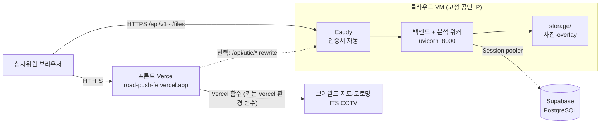

# 테스트 URL 배포

심사위원이 여는 주소는 프론트(Vercel, HTTPS)입니다. 프론트가 부르는 백엔드도 **HTTPS**여야 합니다
(HTTPS 페이지에서 HTTP API·이미지를 부르면 브라우저가 막습니다).

## 1. 구성



| 역할 | 맡는 곳 |
|---|---|
| 화면, 브이월드 배경지도(`/vworld/wmts`), 도로망(`/api/roads`), ITS CCTV(`/api/its/*`) | 프론트 Vercel 함수 (`api/`) |
| 관측·분석·검수·조치 API(`/api/v1`), 사진·overlay(`/files`) | 이 백엔드 |
| UTIC CCTV 재생(`/api/utic/player`) | 선택. UTIC는 등록 IP에서만 응답하므로 고정 IP가 있는 이 백엔드만 가능 |

백엔드에도 `/vworld/wmts`, `/api/its/*` 프록시가 있지만 Vercel 함수가 같은 일을 하므로 배포에서는 쓰지 않아도 됩니다.

## 2. VM 고르기

| 조건 | 이유 |
|---|---|
| 11월 중순(심사 종료)까지 계속 켜져 있음 | 노트북·무료 호스팅의 잠자기 모드는 안 됨 |
| 메모리 8GB 이상 권장 (dummy만이면 1GB) | torch + Mask2Former Swin-L + YOLO 2개 (CPU 추론) |
| 고정 공인 IP | HTTPS 도메인 연결, UTIC 등록 IP |
| 서울·춘천 지역 | Supabase·Vercel(icn1)과 가깝고 UTIC 등록에 유리 |

추천 순서: **Oracle Cloud 상시 무료**(ARM A1, Ubuntu 24.04) → 자리가 없으면 AMD 소형(1GB, 스왑 필요) → AWS 크레딧.
가입 때 무료 한도와 고정 IP 조건을 확인하고, 카드 등록 시 예산 알림을 걸어 둡니다.

Oracle Cloud로 만들 때:
- **홈 리전**은 가입 때 한 번만 고릅니다 → 서울(ap-seoul-1) 또는 춘천(ap-chuncheon-1)
- 인스턴스: Shape `VM.Standard.A1.Flex` **4 OCPU · 24GB**, 이미지 Canonical Ubuntu 24.04, SSH 키 내려받기
- 공인 IP: Networking → Reserved Public IP를 만들어 VM에 붙입니다 (VM을 다시 만들어도 주소 유지)
- `Out of host capacity`가 나오면 다른 가용 영역(AD)을 고르거나 시간을 두고 다시 시도합니다.
  계속 안 되면 계정을 Pay As You Go로 바꾸면 자리가 잘 납니다 (상시 무료 한도 안에서는 과금되지 않음, 예산 알림 필수)

ARM(aarch64)에서도 torch CPU 휠·ultralytics·opencv가 그대로 설치됩니다. CPU 추론이라 사진 1장 분석에 1~3분 걸릴 수 있고,
분석은 워커 큐로 돌아 화면은 "AI 분석 대기 중"을 보이다가 결과로 바뀝니다.

## 3. 설치 순서 (Ubuntu 24.04, `ubuntu` 계정 기준)

### ① 포트 열기
- 클라우드 콘솔의 보안 규칙(Oracle: VCN → Security List)에서 **TCP 80, 443** 인바운드 허용 (22는 기본)
- Oracle Ubuntu 이미지는 OS 방화벽도 막혀 있어 한 번 더 엽니다:
```bash
sudo iptables -I INPUT 6 -m state --state NEW -p tcp --dport 80 -j ACCEPT
sudo iptables -I INPUT 6 -m state --state NEW -p tcp --dport 443 -j ACCEPT
sudo netfilter-persistent save
```

### ② 도메인
VM 공인 IP가 `1.2.3.4`라면 **`1-2-3-4.sslip.io`** 를 그대로 씁니다 (가입 없이 그 IP로 연결되는 무료 도메인).
이름을 고정하고 싶으면 DuckDNS 같은 무료 DNS에서 이름을 만들어 IP를 연결합니다.

### ③ 백엔드
메모리 여유분으로 스왑 4GB를 먼저 만듭니다:
```bash
sudo fallocate -l 4G /swapfile && sudo chmod 600 /swapfile && sudo mkswap /swapfile && sudo swapon /swapfile
echo '/swapfile none swap sw 0 0' | sudo tee -a /etc/fstab
```
```bash
sudo apt update && sudo apt install -y python3.12-venv python3-pip git     # Ubuntu 24.04 기본 Python = 3.12
git clone https://github.com/KingHaKyung/RoadPush_BE.git
cd RoadPush_BE
python3.12 -m venv .venv && . .venv/bin/activate
pip install -U pip
pip install -e .                                                                                # dummy로 먼저 띄울 때는 여기까지
cp .env.example .env && nano .env
```
실제 모델은 AI 코드·모델 파일을 올린 뒤(아래 ⑦) 설치합니다:
```bash
pip install torch==2.7.1 torchvision==0.22.1 --index-url https://download.pytorch.org/whl/cpu   # ARM·x86 모두 CPU 휠
pip install -e ".[ai]"
pip install -e ../RoadPush_AI --no-deps
pip install -e ../RoadPush_AI/surface_passability --no-deps
```
`.env`에서 바꿀 값:
```
DATABASE_URL=postgresql+psycopg://postgres.<ref>:<비밀번호>@<pooler 호스트>.pooler.supabase.com:5432/postgres?sslmode=require
PUBLIC_BASE_URL=https://1-2-3-4.sslip.io
ANALYSIS_ENGINE=roadpush_ai         # 모델을 넣기 전에는 dummy (심사용 결과로 쓰지 않음)
ROADPUSH_AI_ROOT=../RoadPush_AI
SEMANTIC_DEVICE=cpu
DEVICE=cpu
VWORLD_KEY=<브이월드 키>             # 행정구역·주소 자동 채우기
VWORLD_DOMAIN=https://road-push-fe.vercel.app
UTIC_API_KEY=<선택: UTIC 재생을 백엔드로 할 때>
```
처음에는 `ANALYSIS_ENGINE=dummy`로 띄워 프론트 연결까지 확인하고, 모델을 올린 뒤 `roadpush_ai`로 바꿉니다.
비밀번호·키가 든 `.env`는 VM에만 둡니다.

### ④ 자동 실행 (systemd)
```bash
sudo cp deploy/roadpush.service /etc/systemd/system/
sudo systemctl daemon-reload && sudo systemctl enable --now roadpush
curl -s localhost:8000/api/v1/health      # {"status":"ok",...}
journalctl -u roadpush -f                 # 로그
```

### ⑤ HTTPS (Caddy)
```bash
sudo apt install -y caddy
sudo cp deploy/Caddyfile /etc/caddy/Caddyfile
echo "DOMAIN=1-2-3-4.sslip.io" | sudo tee /etc/default/caddy     # Caddyfile의 {$DOMAIN}
sudo systemctl restart caddy
curl -s https://1-2-3-4.sslip.io/api/v1/health
```
`/etc/default/caddy`가 적용되지 않는 배포판이면 Caddyfile 첫 줄 `{$DOMAIN}`을 도메인으로 바꿔 씁니다.

### ⑥ 프론트(Vercel) 연결 — 프론트 담당
1. Vercel 환경 변수 `VITE_API_BASE_URL=https://1-2-3-4.sslip.io/api/v1` → **다시 배포** (빌드 때 들어가는 값)
2. (선택) UTIC 재생까지 하려면 `vercel.json` `rewrites`에 한 줄 추가하고, VM 공인 IP를 UTIC에 등록:
```json
{ "source": "/api/utic/:path*", "destination": "https://1-2-3-4.sslip.io/api/utic/:path*" }
```

### ⑦ AI 코드·모델 올리기
처음 설치(①~⑤) 뒤에는 **⑨ 배포 스크립트**가 아래 묶기·보내기·설치·재시작을 한 번에 합니다. 수동으로 할 때:
서버에는 AI 저장소를 clone하지 않고 **실행에 필요한 파일만** 복사합니다 (`.git`·인증 정보가 서버에 없음).
PC(`C:\dev`)에서 묶습니다. 모델은 AI 저장소 `models/`(Git 제외)에 먼저 넣어 둡니다:
```powershell
cd C:\dev
tar -czf roadpush_ai.tgz --exclude=__pycache__ `
  RoadPush_AI/src RoadPush_AI/pyproject.toml RoadPush_AI/configs RoadPush_AI/schemas `
  RoadPush_AI/surface_passability/src RoadPush_AI/surface_passability/pyproject.toml `
  RoadPush_AI/surface_passability/manifests RoadPush_AI/surface_passability/schemas `
  RoadPush_AI/models
scp -i <SSH 키> roadpush_ai.tgz ubuntu@<공인 IP>:~
```
서버에서 풀고 패키지를 설치한 뒤(위 ③의 실제 모델 설치) 점검합니다:
```bash
cd ~ && tar -xzf roadpush_ai.tgz                       # ~/RoadPush_AI (BE와 나란히)
cd RoadPush_BE && . .venv/bin/activate
python scripts/check_model.py                          # 모델 파일·SHA-256·장애물 클래스
python scripts/check_model.py <사진>                    # 사진 1장 RoadPushAnalyzer → 판정·원인
```
같은 사진을 PC에서도 돌려 `outputs/check_model/<사진>/`의 7-B 결과를 비교합니다 (ARM·x86 CPU 차이 확인).
그다음 `.env`를 `ANALYSIS_ENGINE=roadpush_ai`로 바꾸고 `sudo systemctl restart roadpush`.
AI Hub 데이터로 학습한 장애물 모델은 국외 반출 금지 조건이 있으므로 **국내 리전** 서버에 둡니다.

### ⑧ 시연 데이터
```bash
python scripts/seed_demo.py --base https://1-2-3-4.sslip.io/api/v1
```
또는 화면에서 실제 사진을 등록합니다. 분석이 끝난 상태로 두고 심사를 받습니다.

PC에서 분석까지 끝낸 결과를 그대로 쓰려면 (다시 분석하지 않아 결과가 PC와 같음):
```bash
# PC에서: 서비스 데이터(DB 행) → Supabase. 대상이 비어 있어야 함 (--replace로 덮어쓰기)
python scripts/copy_service_data.py --to "<Session pooler 주소>"
# PC에서: 사진·overlay 파일 → 서버 STORAGE_DIR (DB에는 저장 키만 있음)
scp -r storage/observations storage/analyses ubuntu@<VM IP>:~/RoadPush_BE/storage/
```

### ⑨ 다시 배포할 때 (배포 스크립트, PC에서)
백엔드는 GitHub에서 `git pull`, AI는 `.git` 없이 실행 파일만 묶어 보냅니다 (서버에 Git 인증 정보를 두지 않음).
어떤 AI 코드로 분석했는지 남도록 AI 커밋 번호를 `RoadPush_AI/VERSION.json`에 적어 함께 보내고, `/api/v1/health`에 보입니다.
```powershell
cd C:\dev\RoadPush_BE      # RoadPush_AI가 C:\dev\RoadPush_AI에 나란히 있어야 함
.\deploy\deploy.ps1 -Server <공인 IP> -Key <SSH 키>               # 백엔드 + AI 코드·모델
.\deploy\deploy.ps1 -Server <공인 IP> -Key <SSH 키> -SkipModels   # 모델은 그대로 두고 코드만 (모델 851 MB)
.\deploy\deploy.ps1 -Server <공인 IP> -Key <SSH 키> -SkipAi       # 백엔드만
.\deploy\deploy.ps1 -Server <공인 IP> -Key <SSH 키> -WithStorage  # PC storage/ 사진·overlay도 (copy_service_data.py와 함께)
.\deploy\deploy.ps1 -Server <공인 IP> -DryRun                     # 묶기만 하고 보내지 않음
```
1. 백엔드에 커밋 안 된 변경이 없고 `origin/main`과 같은지 확인 (다르면 멈춤 → push 먼저)
2. AI 저장소 커밋·변경 여부를 `VERSION.json`으로 남기고 묶음 (커밋 안 된 변경이 있으면 멈춤, `-AllowDirtyAi`로 무시)
3. 서버로 보내고 [`deploy/server_update.sh`](../deploy/server_update.sh) 실행: AI 풀기 → `git pull` → 패키지 → `systemctl restart` → health
   (`-CheckModel`이면 끝에 `check_model.py`)
4. `https://<IP>.sslip.io/api/v1/health`의 `backend.commit`·`ai.commit`이 PC와 같은지 확인 (`-Domain`으로 도메인 지정)

```json
{"status": "ok", "analysis_engine": "roadpush_ai",
 "backend": {"commit": "828a361…", "dirty": false, "source": "git"},
 "ai": {"commit": "508221c…", "dirty": false, "branch": "main", "packaged_at": "…", "models": true, "source": "package"}}
```

## 4. 확인 목록

- [ ] `https://<도메인>/api/v1/health`가 브라우저에서 열림 (자물쇠 표시)
- [ ] Vercel 화면 상단에 "백엔드 연결 실패"가 없음, 관측 목록이 백엔드 데이터
- [ ] 상세 화면의 사진·overlay가 보임 (주소가 `https://`로 시작 → `PUBLIC_BASE_URL`)
- [ ] 처리 상태·검수·메모를 바꾸고 새로고침해도 유지
- [ ] VM을 재부팅해도 백엔드·Caddy가 다시 뜸
- [ ] (실제 모델) `/api/v1/health`의 `analysis_engine`이 `roadpush_ai`, 사진 1장이 "분석 대기"에서 결과로 바뀜 — 걸린 시간·`free -h` 기록
- [ ] (실제 모델) 같은 사진의 7-B 결과가 PC와 서버에서 같음 (ARM·x86 차이 확인)
- [ ] 휴대폰(다른 네트워크)에서도 열림

## 5. 주의

- **사진은 VM 디스크에 저장**됩니다 (`storage/`). VM을 지우기 전에 내려받아 둡니다.
- Supabase 무료 플랜은 오래 쓰지 않으면 일시정지될 수 있어 심사 기간 중 대시보드를 확인합니다 ([DB.md 1장](DB.md)).
- `/api/v1`은 로그인이 없습니다. 주소를 아는 사람은 데이터를 바꿀 수 있으므로 심사용 시연 데이터만 넣습니다.
- 공개 URL로 YOLO(Ultralytics)를 서비스하면 AGPL 조건이 적용됩니다. 성과보고서에 사용 모델과 라이선스를 적습니다.
- 심사가 끝나면 VM과 고정 IP를 모두 삭제합니다 (쓰지 않는 고정 IP도 과금될 수 있음).

## 6. VM을 못 만들 때

| 방법 | 장점 | 한계 |
|---|---|---|
| Cloudflare Tunnel (내 PC → HTTPS 주소) | 무료, PC의 GPU(RTX 4060) 사용, 포트 개방 불필요 | PC가 심사 기간 내내 켜져 있어야 함. 임시 터널은 다시 켤 때마다 주소가 바뀜(그때마다 Vercel 재배포) → **시연 영상 녹화용**으로 적합 |
| Hugging Face Spaces (Docker) | 무료 CPU, HTTPS 기본 | 오래 안 쓰면 잠듦, 재시작 때 디스크 초기화(사진 사라짐), 고정 IP 없음(UTIC 불가) |
