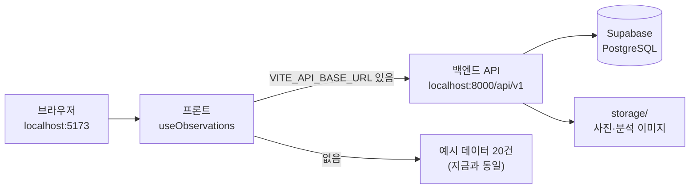
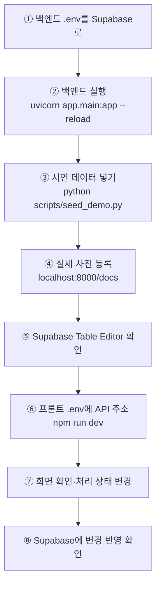

# 프론트 ↔ 백엔드 연결 가이드

프론트(`RoadPush_FE`)가 예시 데이터 대신 백엔드 API의 데이터(Supabase에 저장된 관측)를 보여 주도록 바꾸는 방법입니다.
**프론트 담당**이 적용하고, 백엔드 담당이 아래 "전체 테스트 순서"로 확인합니다.

- 적용 파일: [`docs/frontend/api-connect.patch`](frontend/api-connect.patch) (프론트 8개 파일, +189 / −33줄)
- 기준: 프론트 `main` `21b5ed1`에 그대로 적용되는 것을 확인했습니다.
- 확인 결과: 백엔드(PostgreSQL) + 시연 데이터 + 프론트 개발 서버를 브라우저로 띄워 아래 항목이 동작함을 확인했습니다.
  - 관측 목록에 백엔드 데이터 표시, 상세에서 실제 사진·분석 이미지 표시
  - 목록에서 처리 상태를 바꾸면 백엔드(DB)에 저장
  - 백엔드가 꺼져 있으면 상단에 "백엔드 연결 실패" 표시
  - `VITE_API_BASE_URL`을 비우면 지금과 똑같이 예시 데이터 20건으로 동작



## 1. 적용 방법 (프론트 담당)

두 저장소가 같은 상위 폴더에 나란히 있다고 가정합니다 (`C:\dev\RoadPush_BE`, `C:\dev\RoadPush_FE`).

```powershell
cd C:\dev\RoadPush_FE
git checkout main
git pull
git checkout -b feat/api-connect
git apply --check ..\RoadPush_BE\docs\frontend\api-connect.patch   # 아무것도 안 나오면 적용 가능
git apply ..\RoadPush_BE\docs\frontend\api-connect.patch
npm run build                                                       # 타입 검사 + 빌드 확인
git add -A
git commit -m "백엔드 API 연결 (VITE_API_BASE_URL 있으면 API, 없으면 예시 데이터)"
git push -u origin feat/api-connect
```
GitHub에서 `feat/api-connect` → `main` Pull Request로 검토 후 합칩니다.

**`git apply --check`가 실패하면** 그사이 프론트 코드가 바뀐 것입니다. `git apply --3way ..\RoadPush_BE\docs\frontend\api-connect.patch`로 시도하고,
충돌이 나면 아래 2장의 파일별 설명을 보고 직접 반영합니다.

## 2. 무엇이 바뀌나

| 파일 | 변경 |
|---|---|
| `src/api/client.ts` | 백엔드 응답 형식 전체(마스터 문서 4.4 + 화면용 필드), 관측 조회·처리 상태·사람 판정·재분석 호출, 응답 → 화면 데이터 변환(`toObservation`) |
| `src/lib/useObservations.ts` | `VITE_API_BASE_URL`이 있으면 API 모드, 없으면 기존 예시 데이터 모드. API 모드는 5초마다 다시 읽어 "분석 대기 중"이 결과로 바뀌게 함 |
| `src/types.ts` | 수집 경로에 `upload`(직접 업로드) 추가, 관측에 사진 주소 `img` 추가 |
| `src/lib/constants.ts` | `upload` 표시 이름, API 모드에서는 기준 시각을 현재 시각으로 (예시 모드는 기존 고정 시각) |
| `src/App.tsx` | 기본 필터에 `upload` 포함, 연결 오류를 상단에 전달 |
| `src/components/MapView.tsx` | 수집 경로 필터에 "직접 업로드" 추가 |
| `src/components/FrameView.tsx` | 사진 주소가 있으면 그림 대신 **실제 사진** 표시 ('분석' 보기면 분석 이미지) |
| `src/components/Header.tsx` | API 모드: 최종 촬영 시각·수집 경로별 건수·"백엔드 연결/연결 실패" 표시. 예시 모드: 기존 그대로 |

### 화면 동작 → 백엔드 호출

| 화면 동작 | 호출 |
|---|---|
| 화면 열기, 5초마다 | `GET /observations` |
| 처리 상태·담당 부서 변경 (단건·일괄) | `POST /observations/bulk-action` |
| 판단 유보에서 사람 판정 | `POST /observations/{id}/reviews` (`corrected`) |
| 재분석 요청 | `POST /observations/{id}/reanalyze` |
| 사진·분석 이미지 | 응답의 `images` 주소 (`/files/…`) |

### 백엔드 값 → 화면 값

| 백엔드 | 화면 |
|---|---|
| `passability` `undetermined` / 분석 전·실패(`null`) | `hold`(판단 유보). 사유에 "AI 분석 대기 중" 또는 "분석 실패: …" |
| `review_status` `pending` · `confirmed` · `corrected` | `미검수` · `확인` · `수정` |
| `action.label`, `action.dept` (`null`) | 처리 상태, 담당 부서 (`미배정`) |
| `link_id` | 지도 구간. 예시 지역 링크가 아니면 좌표에서 가장 가까운 링크 |
| `location` 없음 | 위치 확인 전이라 화면에서 제외 |

### 아직 백엔드에 저장되지 않는 것
화면에서 눌러도 동작은 하지만 새로고침하면 사라집니다. 필요해지면 백엔드에 API를 추가합니다.
- 사람 판정 **취소**, 재분석 요청 **취소**
- 상세의 **메모** (처리 상태를 함께 바꿀 때는 조치 메모로 저장됨)
- 행정구역·주소(`area`, `addr`): 등록할 때 넣은 값만 표시 (자동 역지오코딩 없음)

## 3. 전체 테스트 순서 (백엔드 담당)



### ① 백엔드를 Supabase에 연결
`RoadPush_BE\.env`의 `DATABASE_URL`을 Supabase 주소로 바꿉니다 ([DB.md 2장](DB.md#2-supabase-연결-순서)). `SURFACE_MODEL=dummy`는 그대로 둡니다.

### ② 백엔드 실행 (터미널 1)
```powershell
cd C:\dev\RoadPush_BE
.venv\Scripts\Activate.ps1
uvicorn app.main:app --reload
```

### ③ 시연 데이터 넣기 (터미널 2)
```powershell
cd C:\dev\RoadPush_BE
.venv\Scripts\Activate.ps1
python scripts/seed_demo.py
```
구간 4곳, 관측 8건, 검수 1건, 조치·전후 비교 1건이 들어갑니다. 사진은 무늬만 있는 가짜 이미지입니다.

### ④ 내가 찍은 사진 등록
http://localhost:8000/docs → `POST /api/v1/observations` → **Try it out**

| 칸 | 입력 예 |
|---|---|
| file | 휴대폰 사진 (jpg) |
| captured_at | `2026-10-22T14:30:00+09:00` (찍은 시각) |
| lat / lng | `37.3856` / `127.1195` (분당구 예시 지역 안이면 지도에 바로 보임) |
| new_site_name | `서현동 현장 1` (처음 등록하는 장소) |
| source | `upload` |

**Execute** → 응답의 `observation_id`를 기억합니다. 판정은 dummy 모델이라 의미가 없고, 사진이 화면에 보이는지만 확인합니다.
같은 장소를 또 등록할 때는 `new_site_name` 대신 응답의 `site_id`를 넣습니다.

### ⑤ Supabase에서 확인
Table Editor → `sites`, `observations`, `analyses`에 행이 생겼는지 확인합니다. `analyses.status`가 `completed`면 분석 완료입니다.

### ⑥ 프론트 실행 (터미널 3, 패치를 적용한 브랜치에서)
`RoadPush_FE\.env`:
```
VITE_VWORLD_KEY=브이월드_인증키
VITE_API_BASE_URL=http://localhost:8000/api/v1
```
```powershell
cd C:\dev\RoadPush_FE
npm run dev
```
`.env`를 바꾸면 `npm run dev`를 껐다 다시 켜야 반영됩니다.

### ⑦ 화면에서 확인할 것
http://localhost:5173

| 확인 | 기대 결과 |
|---|---|
| 오른쪽 위 | "백엔드 연결" 배지, "직접 업로드 N건" |
| 관측 목록 → 기간 **전체** | 시연 데이터 + 내가 올린 사진이 모두 보임 (기본값 "최근 3일"이면 일부만 보임) |
| 목록에서 행 선택 → 상세 | 실제 사진. '원본/분석' 전환 시 분석 이미지 |
| 위험 지도 | 예시 지역(분당구 서현·수내) 안의 관측이 핀으로 표시 |
| 처리 상태를 "현장점검 요청"으로 변경 | 토스트 후 값 유지 (새로고침해도 유지) |

### ⑧ Supabase에서 변경 확인
Table Editor → `actions`, `action_logs`에 방금 바꾼 처리 상태가 들어갔는지 확인합니다.

### 끝나면
- 백엔드 `.env`의 `DATABASE_URL`을 SQLite로 되돌립니다 ([DB.md 운영 규칙](DB.md#1-db-구성)).
- 내 사진 파일은 내 PC의 `storage/`에만 있으므로, 배포 서버에서는 같은 사진이 보이지 않습니다.

## 4. 자주 나는 문제

| 증상 | 원인·해결 |
|---|---|
| 상단에 "예시 데이터" 그대로 | 프론트 `.env`에 `VITE_API_BASE_URL`이 없거나 `npm run dev`를 다시 켜지 않음 |
| "백엔드 연결 실패" | 백엔드가 꺼져 있음, 주소 끝이 `/api/v1`이 아님. 브라우저에서 http://localhost:8000/api/v1/health 확인 |
| 브라우저 콘솔에 CORS 오류 | 백엔드 `.env`의 `CORS_ORIGINS`에 프론트 주소(`http://localhost:5173`) 확인 후 백엔드 재시작 |
| 목록에 1~2건만 | 기간 필터가 "최근 3일". **전체**를 누름 |
| 지도에 핀이 없음 | 사진 좌표가 예시 지역(경도 127.108~127.134, 위도 37.3745~37.3905) 밖. 목록에는 보임 |
| 사진 대신 깨진 이미지 | 백엔드를 다른 PC·다른 `STORAGE_DIR`로 실행 중 (사진은 등록한 PC에만 있음) |
| 콘솔에 `nodelink/index.json` 404 | 전국 도로 타일을 만들지 않은 상태라 나는 기존 메시지. 예시 지역 지도에는 영향 없음 |

## 5. 배포(테스트 URL)할 때
- Vercel 프로젝트 환경 변수에 `VITE_API_BASE_URL=https://<백엔드 주소>/api/v1` 추가 후 다시 배포
- 백엔드는 **HTTPS** 주소여야 합니다 (HTTPS 페이지에서 HTTP API 호출은 브라우저가 차단) — [GUIDE.md 5장](GUIDE.md#테스트-url-배포-구성)
- 백엔드 `CORS_ORIGINS`에 `https://road-push-fe.vercel.app` 포함 (기본값에 들어 있음)
