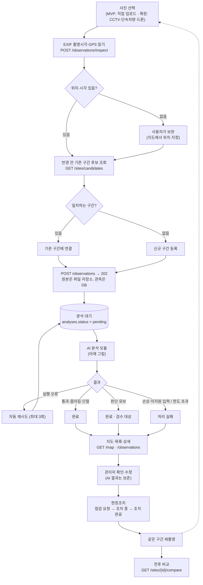
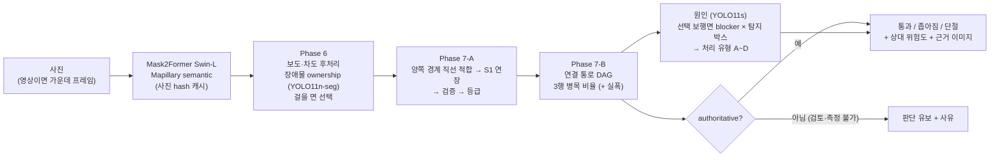
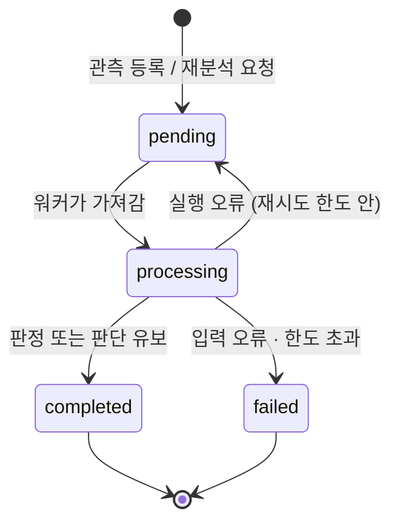
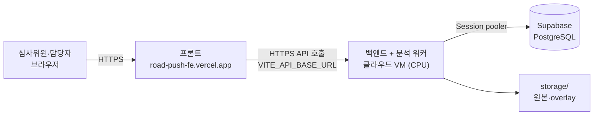

# RoadPush 백엔드 가이드

> 기준: 마스터 설계·근거 문서 V4, 원 제안서, 사전질의 답변서 1~3, 산업통상부 공고 제2026-614호.
> 로컬 실행 [SETUP.md](SETUP.md) · DB [DB.md](DB.md) · API [API.md](API.md) · 계산 규칙 [PASSABILITY.md](PASSABILITY.md)

## 1. 판단 대상과 범위

**"보행자가 차도로 내려가지 않고 계속 걸을 공간이 남아 있는가."**
장애물의 수나 종류가 아니라, 보도를 따라 입구부터 출구까지 이어지는 통로가 **유지되는지 · 좁아지는지 · 끊겨 차도 우회가 필요한지**를 봅니다.

| 항목 | 기준 (근거) |
|---|---|
| 이용자 | 일반 보행자. 휠체어·유모차 기준은 확장 과제 (답변서1·3) |
| 위험 | 차도 이탈에 따른 차량 충돌. 낙상·범죄 제외 (답변서2) |
| 단절 | 구조적 단절 + 불법주정차·공사시설·적치물로 막혀 차도 우회가 필요한 상태 (답변서2) |
| 판정 | 통과 가능 / 좁아짐 / 단절·우회 필요 / 판단 유보 — 좁음과 불통을 구분 (답변서1) |
| 폭 | 상대비율 기본, 임계값은 팀 결정 (답변서3) |
| 장면 | 경계가 분명한 보도. 보차혼용도로는 단계적 확장 (답변서1) |
| 입력 | 사진 중심, 영상은 여러 수단 중 하나. 어떤 데이터든 비식별화 필요 (답변서2) |
| 사용자 | 지자체·도로관리기관 (B2G). 개인 길찾기·주민 제보는 핵심 범위 아님 (답변서3) |
| 궤적 | 보행자 궤적은 관측자료일 뿐 정상 보행공간 근거가 아님. 차도 우회 궤적은 이탈 신호 (답변서1) |

주장하지 않는 것: 모든 촬영 시점·모든 적치물·개인 길찾기·모든 교통약자 접근성 검증, 위험도 감소 = 사고 감소.

## 2. 처리 흐름

### 전체 서비스 흐름



### AI 분석 모듈 안 (`ANALYSIS_ENGINE=roadpush_ai`)

RoadPush_AI 통합 진입점 `RoadPushAnalyzer`를 그대로 부릅니다(`roadpush.py`). 백엔드는 응답을 판정으로 바꿉니다(`passability/phase7.py`).


`dummy` 엔진은 모델 없이 가짜 장면 + 백엔드 임시 규칙(`rules.py`)으로 같은 응답을 만듭니다 ([PASSABILITY.md](PASSABILITY.md)).

### 상태가 바뀌는 방식



검수(`review_status`)와 조치(`action.state`)는 위 처리 상태와 따로 기록합니다. 재분석하면 새 분석이 생기고 검수는 미검수부터 다시 시작합니다.

## 3. 폴더 구조 (마스터 문서 6장)

```
app/
  api/                 등록·지도·상세·검수·조치·비교 라우터, 응답 형식(schemas.py = 4.4)
  services/            관측 처리·AI 호출·저장/조회 (worker, analysis, views, exif, storage, nodelink)
  ai_engine/           분석 (DB를 모름)
    pipeline.py        AI 모듈 진입점 (ANALYSIS_ENGINE: roadpush_ai | dummy)
    roadpush.py        RoadPush_AI RoadPushAnalyzer 호출 (사진 1장 → 통합 응답 + overlay용 mask)
    causes.py          AI 응답 surface_obstacles → 원인 배지·처리 유형
    passability/       7-B 결과 → 판정(phase7) · 상대 위험도(risk) · overlay · dummy 규칙(rules)
    surface/ scene.py  dummy 엔진 (가짜 장면, 영상 프레임 융합)
  db/                  DB 연결·테이블 정의(models.py)
migrations/            DB 스키마 변경 이력 (Alembic) → DB.md
model_weights/         (사용 안 함) 모델은 RoadPush_AI 저장소 models/ (Git 제외)
storage/               서비스 원본·mask·overlay (Git 제외)
data/                  학습·평가 자료 (Git 제외, 표준노드링크 예시만 포함)
scripts/               analyze_folder.py (일괄 분석·보정) · seed_demo.py (시연 데이터)
outputs/  work/        실험 결과·임시 (Git 제외)
docs/
```

## 4. 모델 운용

| 역할 | 모델 (RoadPush_AI) | 위치·설정 |
|---|---|---|
| 노면 semantic | Mask2Former Swin-L Mapillary Vistas | `ROADPUSH_AI_ROOT/models/surface_passability/semantic/`, `SEMANTIC_DEVICE=cpu`(AI 팀 기준) |
| 차량 instance (7-B 점유 보강, 조건부) | YOLO11n-seg | `ROADPUSH_AI_ROOT/models/surface_passability/yolo11n-seg.pt` (CPU) |
| 장애물 원인 | YOLO11s `obstacle_v2_yolo11s_full_os4` (vehicle·construction·debris·micromobility) | `ROADPUSH_AI_ROOT/models/obstacle_detection/`, 설정 `configs/obstacle_detection.yaml`(임계값·imgsz 640·SHA-256), `DEVICE=auto` |
| 연결 확인 | dummy | `ANALYSIS_ENGINE=dummy` (기본값). 모델 없이 API·프론트 확인 |

- 모델·가중치는 Git에 없습니다 (AI 저장소 `models/`, 다른 곳이면 `ROADPUSH_MODEL_ROOT`). 설치·점검: [SETUP.md 8장](SETUP.md#8-실제-모델-실행-roadpush_ai-팀-파이프라인), `python scripts/check_model.py 사진.jpg`
- `roadpush_ai`는 Python 3.12 · torch 2.7.1 기준입니다 (AI 저장소 requirements와 같은 버전을 `pyproject.toml`의 `ai`에 고정).
- 걸리는 시간: AI 팀 측정 사진 1장 평균 GPU 2.3초 · CPU 3.4초 (RTX 5070 Ti Laptop, 160장). 첫 사진은 모델을 올리느라 더 걸립니다.
  심사 전 시연 데이터는 미리 분석해 둡니다. 분석은 큐로 돌아 화면이 멈추지 않습니다.

## 5. 공모전 제출물과 백엔드가 맡을 일

마감 **10/31(토) 24:00**, `relations2@keit.re.kr` 메일 접수. 주말이라 문의 답변 불가 → 10/30 제출 권장.

| 제출물 | 필수 | 백엔드 관련 |
|---|---|---|
| 성과보고서 (탐구인력·문제정의·AI 접근·결과 해석·한계·개선) | 필수 | 판정 규칙·현장 평가 결과표·한계 |
| 참가신청서 (전원 정보, 대표 서명) | 필수 | — |
| **웹 서비스 테스트 URL** | 필수 | **프론트·백엔드를 외부에서 접속 가능하게 배포** (심사 기간 11월 중순까지 유지) |
| 데모 시연 영상 2~5분 | 필수 | 업로드 → 분석 → 지도 → 검수·조치 → 재촬영 전후 비교 |
| GitHub 링크 또는 AI 코드 | 선택 | 이 저장소 (공개 여부·가중치·데이터 재배포 조건 확인) |
| 학습 데이터 요약·샘플 결과물 | 선택 | `scripts/analyze_folder.py` 결과·overlay |

심사: 대국민 투표 50% + 전문가 50% (문제정의·AI 구현 수준·완성도·사회문제 기여·창의적 응용). 후보작 구현 가점 5점.

### 테스트 URL 배포 구성



- 프론트는 이미 Vercel(HTTPS)에 배포되어 있습니다. HTTPS 페이지는 HTTP API를 부를 수 없으므로(브라우저 혼합 콘텐츠 차단)
  **백엔드도 HTTPS 주소**가 필요합니다. VM 앞에 리버스 프록시(Caddy 등)로 인증서를 붙이거나, HTTPS를 기본 제공하는 호스팅을 씁니다.
- 백엔드 `.env`: `DATABASE_URL`(Supabase), `CORS_ORIGINS`에 `https://road-push-fe.vercel.app` 포함(기본값에 들어 있음)
- 프론트 Vercel 환경 변수: `VITE_API_BASE_URL=https://<백엔드 주소>/api/v1`
- 지도·도로망·ITS CCTV는 프론트 Vercel 함수가 처리합니다. UTIC 영상만 고정 IP가 필요해 선택으로 백엔드에 넘깁니다.
- 설치·HTTPS(Caddy)·자동 실행·확인 목록: **[DEPLOY.md](DEPLOY.md)**
- 심사 기간(11월 중순까지) 내내 켜져 있어야 하므로 노트북 서버는 쓰지 않습니다. CPU에서는 사진 1장 분석에 수십 초~수 분이 걸릴 수 있어 메모리 8GB 이상 VM과 미리 분석해 둔 시연 데이터를 권장합니다 (4장).
- 심사위원이 바로 볼 수 있게 분석이 끝난 시연 데이터를 미리 넣어 둡니다 (`scripts/seed_demo.py --base https://<백엔드 주소>/api/v1` 또는 실제 사진 등록).

## 6. 일정 (10/21 ~ 10/31)

| 날짜 | 팀 일정 | 백엔드 |
|---|---|---|
| 10/21 수 | 추가 라벨링 | 팀원 로컬 실행 확인 ([SETUP.md](SETUP.md)) · Supabase 프로젝트 생성 · 프론트와 API 합의 |
| 10/22 목 | 미세조정 | 모델 팀에서 TorchScript·YOLO 가중치 받기 → 실제 모델로 사진 10~20장 |
| 10/23 금 | 현장 실측 | 보정용 장소 사진 + 전체 보도폭·남은 폭·현장 판정 기록 (`labels.csv`) |
| 10/24 토 | 임계값 보정 | `analyze_folder.py`로 혼동행렬 → 60%/30% 조정 → 정책 버전 고정 |
| 10/25 일 | 추론 파이프라인 | 배포 서버 준비 (테스트 URL) |
| 10/26 월 | 백엔드 연결 | 프론트 `VITE_API_BASE_URL` 연결 |
| 10/27 화 | 지도·검수표 | 처리중·실패·유보·검수·조치·전후 비교 화면 연동 |
| 10/28 수 | 최종 현장검증 | **보정에 안 쓴 장소** 사진으로 최종 평가 (규칙 고정 후) |
| 10/29 목 | 제출물 완성 | 시연 데이터 고정, 데모 영상 녹화, 성과보고서 |
| 10/30 금 | 최종 검수 및 제출 | 테스트 URL·영상·서류 최종 점검 후 메일 제출 |
| 10/31 토 | 공모전 마감 | 24:00 (주말이라 문의 불가) |

## 7. 미정 사항

1. 임계값(60%/30%)·위험도 가중치 — 10/24 보정 후 확정
2. 구간 후보 검색 반경 (기본 50 m) — 실제 GPS 오차 보고 조정
3. 위험정보 유효시간 (답변서1: 팀 결정). 현재는 "최신 촬영 관측"만 보여 주고 만료는 없음
4. 배포 서버 (VM 종류)
5. 저장소 공개 여부와 데이터·가중치 사용 조건 (AI Hub 수락 조건·국외 반출 금지, Mask2Former·Mapillary Vistas 조건, Ultralytics AGPL)
6. 직접 촬영 사진의 얼굴·번호판 비식별 방법 (답변서2: 필수)
7. 장애물 클래스 분리 — 모델 팀 확정안은 vehicle·construction·debris·micromobility. 오토바이·입간판·쓰레기 분리 여부 확인 중이며, 백엔드 매핑은 두 경우 모두 처리 ([FRONTEND_INTEGRATION.md 2-2](FRONTEND_INTEGRATION.md#2-2-원인-배지-이름-causes))
8. 참조 레이어 범위 — 받은 데이터는 서울만 있어 성남 시연 구간에는 보도 폭이 붙지 않음 ([DB.md 6장](DB.md#6-참조-레이어-서울-보행-링크--도로구간--보도-구간))
