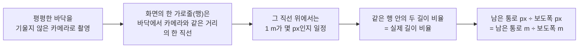
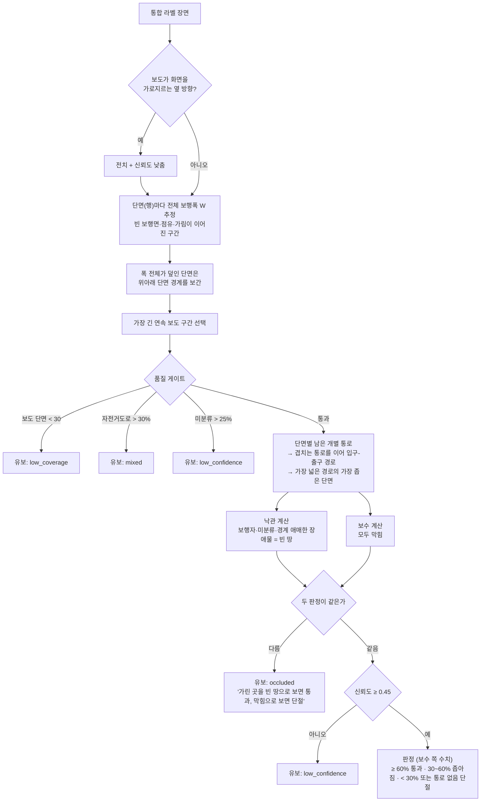
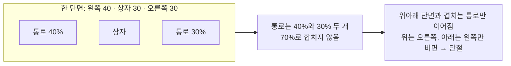

# 통과 여부·위험도 계산 (`app/ai_engine/passability/`)

| 엔진 (`ANALYSIS_ENGINE`) | 통로 폭 계산 | 판정 | 문서 |
|---|---|---|---|
| **`roadpush_ai` (서비스·심사용)** | RoadPush_AI 팀 Phase 7-B (`phase7_b_result_v2`) | `passability/phase7.py` | 0장 |
| `dummy` (흐름 확인용) | 백엔드 임시 규칙 `rules.py` (`rules-2026.10-b`) | `rules.py` | 1~7장 |

1~7장은 AI 팀 파이프라인을 받기 전에 만든 백엔드 임시 규칙입니다. 지금은 dummy 엔진과 `scripts/analyze_folder.py`의
규칙 실험에만 쓰고, 상대 위험도(5장)와 상대폭 기준값(`Policy.passable_min_ratio`·`blocked_below_ratio`)은 두 엔진이 같이 씁니다.

## 0. AI 팀 Phase 7-B 결과 → 판정 (`phase7.py`, `phase7-consumer-2026.10`)

AI 계약: RoadPush_AI `docs/PRODUCTION_SYSTEM.md` (10~12장). 백엔드는 **값을 다시 계산하지 않고 소비 규칙만** 적용합니다.

| 7-B 결과 | 판정 | 위험도·통로 비율 | 유보 코드 |
|---|---|---|---|
| `selected_surface = null` (Phase 6이 걸을 면을 못 정함) | 판단 유보 | 없음 | `surface_uncertain` |
| `result_authority = provisional_review` (7-A `ambiguous_hold`) | 판단 유보 (사람 검토) | **없음** — 가계산 비율은 사유 문장에만 | `boundary_review` |
| `result_authority = none` 또는 `minimum_passable_ratio = null` | 판단 유보 | 없음 (null을 0으로 바꾸지 않음) | `boundary_failed`·`occupancy_unverified`·`low_coverage` |
| authoritative + `passability_state` = passable·narrowed·blocked | **AI 판정 그대로** (비율 0 = 단절, 또는 실폭 입력으로 m 단위 판정) | `minimum_passable_ratio` | — |
| authoritative + `relative_only` (실폭·통행 폭 입력 없음) | 상대폭 기준: 통과 ≥ 60%, 단절 < 30% (`rules.Policy`, 현장 보정 대상) | `minimum_passable_ratio` | — |

- 판정·위험도에는 3행 robust 병목 `minimum_passable_ratio`만 씁니다. `raw_minimum_passable_ratio`(단일 행 최저)는 쓰지 않습니다.
- `measurement_scope = partial`(경계가 확정된 앞부분만)은 판정을 내되 사유에 "앞부분만 측정"을 붙입니다.
- `bottleneck_m_est` = `absolute_passable_width_m` (구간 `sidewalk_width_m`이 있을 때). `effective_blocked_width_m`는 장애물 폭이 아니라서 화면에 내지 않습니다.
- `.env`에 `AGENT_WIDTH_M`(예: 휠체어 0.9)·`SAFETY_FACTOR`(예: 1.2)를 넣고 구간 보도 폭이 있으면 7-B가 m 단위로 통과·좁아짐·단절을 냅니다.
- `confidence`는 비웁니다. AI는 수치 대신 등급(`measurement_confidence`)을 내며 `evidence.stats`에 남습니다.
- 원인 배지는 AI 통합 응답 `surface_obstacles` 그대로입니다 (`roadpush_ai/attribution.py`, `phase7b_occupancy_overlap_v2`: 최종 7-B 폭 계산에 쓴 점유와 겹친 탐지만).
  최종 7-B 폭 계산에 쓴 점유 덩어리와 겹친 탐지만 원인이고, 클래스가 없는 덩어리만 있으면 `장애물`입니다.
  민원 자동 전달 가능 여부(`evidence.cause.auto_routable`) = 원인이 있고 authoritative (AI가 계산).
- 장애물 단계만 실패한 응답(`status = partial`)은 원인 없이 저장하지 않고 실행 오류로 재시도합니다.

### 근거 (`analyses.evidence`, roadpush_ai)

| 키 | 내용 |
|---|---|
| `response` | AI 원본 응답 `response.to_dict()` 전체 (`roadpush_analysis_response_v1`: `surface`·`surface_obstacles`·`diagnostics`) |
| `phase7b` | 7-B 기록 전체 (`phase7_b_result_v2`, 응답 `surface.passability`). 로컬 경로는 저장소 기준 상대 경로로 바꿈 |
| `selection` | Phase 6 surface 선택 요약 |
| `cause` | `surface_obstacles` 상태·덩어리별 원인·접점 탐지 박스·`auto_routable` |
| `versions`·`idempotency_key`·`image_sha256` | 응답·모델·정책 버전, AI 문서 12장 멱등 key |
| 파일 | semantic 캐시 `STORAGE_DIR/ai/semantic_cache` (사진 hash·모델 identity가 key). 영상은 `analyses/<id>/ai/attempt-N/frame.png` |

### 새 사진 처리 방식
- 백엔드는 단계를 직접 잇지 않고 AI 통합 진입점 `RoadPushAnalyzer.analyze_photo()`를 한 번 부릅니다 (`roadpush.run_photo()`).
- AI 공개 응답에는 mask가 없어서, overlay용 mask는 같은 실행의 Surface in-memory 근거에서 받습니다 (다시 계산하지 않음).

---

# 백엔드 임시 규칙 (dummy 엔진)

마스터 문서 9장 팀 합의를 구현한 것입니다. 규칙 `rules-2026.10-b`, 정책 `policy-2026.10-draft`(보정 전 초안).
값이나 로직을 바꾸면 버전을 올려야 이전 분석과 비교할 수 있습니다.

## 1. 상대 수치와 절대 수치

| | 상대 수치 (기본) | 절대 수치 (선택, 보조) |
|---|---|---|
| 뜻 | 남은 연속 통로 ÷ 같은 단면의 전체 보행폭 (예: 45%) | 미터 (예: 1.1 m) |
| 사진 한 장으로 | **가능** (아래 2장) | 불가능. 사진만으로는 축척을 모름 |
| 판정(통과·좁아짐·단절) | **이것으로 함** | 쓰지 않음 |
| 상대 위험도 | **이것으로 함** | 쓰지 않음 |
| 응답 필드 | `bottleneck_ratio`, `occupancy`, `risk_score` | `bottleneck_m_est` (구간에 실측 보도폭이 있을 때만) |
| 근거 | 원 제안서(원근 오차 때문에 비율 중심), 답변서3(상대비율 기본), 마스터 문서 9장 | 마스터 문서 12장: 절대폭·GIS는 확장, 초기 MVP의 선행 조건 아님 |

사진 한 장에서는 축척을 알 수 없으므로 절대 수치는 판정·위험도에 쓰지 않고 참고값으로만 붙입니다.
같은 45%라도 2 m 보도의 45%(0.9 m)와 4 m 보도의 45%(1.8 m)는 다르며, 이 차이는 아래 절대 수치 출처로 보완합니다 (4장).

### 절대 수치 출처

| 출처 | 얻는 값 | 지금 상태 | 비고 |
|---|---|---|---|
| **현장 실측 (줄자)** | 구간의 전체 보도폭 | **구현됨** — `Site.sidewalk_width_m`에 넣으면 `상대폭 × 실측폭` | 10/23 현장 실측 때 같이 잴 수 있음. 가장 확실 |
| 사진 속 규격 물체 | 축척 (m/px) | 미구현 | 점자블록(규격 크기)·보도블록·연석이 같은 단면에 보이면 그 픽셀 폭으로 축척 계산 |
| 고정 CCTV 보정 | 바닥 좌표 변환(호모그래피) | 미구현 | 같은 화각을 반복 관측할 때 한 번만 바닥 4점을 실측 |
| 공공 데이터 | 보도폭 속성 | 미구현 | 서울 보도 데이터(Zenodo, 마스터 문서 7장)에 폭 속성이 있음. 지역이 한정되고 촬영 위치와 정합 필요. 연속수치지형도 도로폭은 **차도** 폭이라 보도폭이 아님 |
| 단안 깊이 추정 모델 + 카메라 정보 | 픽셀별 거리 → 축척 | 미구현 | 연구 단계. 오차 검증 없이 판정에 쓰면 안 됨 |
| 휴대폰 AR·LiDAR 측정 | 실제 거리 | 범위 밖 | 촬영 앱이 필요 |

## 2. 원근과 상대 폭 비율



- 가까운 행은 1 m = 200 px, 먼 행은 1 m = 40 px처럼 행마다 축척이 다르지만, **분자와 분모를 같은 행에서 재기 때문에 축척이 약분**됩니다.
  그래서 서로 다른 행의 픽셀 폭끼리는 절대 비교하지 않고, 행마다 비율로 바꾼 뒤에만 비교합니다.
- 보도를 비스듬히 찍어도(카메라가 보도 방향과 어긋나도) 한 행은 보도를 비스듬히 자르는 직선이 되고,
  전체 폭과 남은 폭이 **같은 각도로 같이 늘어나** 비율은 그대로입니다.
- 그래서 판정 기준(60%·30%)을 사진마다 바꾸지 않고 하나로 쓸 수 있습니다.

이 근사가 깨지는 조건이 곧 한계입니다 (4장).

## 3. 계산 단계

### 입력: 통합 라벨 장면

노면 semantic mask(보도·차도)에 차량·비차량 instance mask를 덮어 만든 H×W 라벨 지도.

| 값 | 라벨 | 규칙에서 |
|---|---|---|
| 1 | SIDEWALK | 빈 보행면 (보도 재질 병합, 점자블록) |
| 7 | BIKE_LANE | 빈 보행면 후보. 보도 범위의 30% 넘게 섞이면 **판단 유보(mixed)**. DeepLab class1(아스팔트·우레탄 보도 + 자전거도로)은 여기로 → 정상 보행면으로 전역 확정하지 않음 |
| 4 | OBSTACLE | 장애물 **전체 실루엣 = 점유 후보** (차량 문·창문·지붕 포함) |
| 5 | TRANSIENT | 보행자. 점유가 아니라 지면을 가리는 것 |
| 0 | UNKNOWN | 가림 취급. 보도 범위의 25% 넘으면 유보 |
| 2, 3, 6 | ROAD, CURB, BACKGROUND | 보도 범위의 끝. 상시 고정시설(가로수·가로등·전봇대·볼라드·벤치)은 BACKGROUND |

### 흐름



### 연속 통로 — 개별 통로를 합치지 않는다



- 경로의 값 = 지나는 단면들 중 가장 좁은 통로 비율 (병목). 이웃 단면 사이에서 통로가 겹친 폭도 병목 후보입니다.
- 입구에서 출구까지 가는 경로 중 병목이 가장 넓은 경로를 찾습니다 (max-min 경로).
- 보도 경계 끝이 장애물이고 그 너머가 연석·벽이 아니라 차도·화면 끝이면 "경계 애매"로 표시합니다
  (차도 위 차량이 보도를 가린 건지, 보도에 올라온 건지 모름 → 낙관·보수가 갈리면 유보).
- 작은 노면 오류를 morphology로 메우지 않습니다 (실제 차단까지 지워질 수 있음).

60%·30%는 **보정 전 가정값**입니다. 보정용 장소 실측으로 정하고 최종 평가 전에 고정합니다.

## 4. 한계와 극복 방법

| 한계 | 왜 생기나 | 지금 처리 | 극복 방법 (우선순위 순) |
|---|---|---|---|
| **같은 비율, 다른 실제 폭** (2 m 보도의 45% ≠ 4 m 보도의 45%) | 상대 수치는 축척이 없음 | 실측폭이 있으면 `bottleneck_m_est`를 덧붙임 | ① 현장 실측 구간에 보도폭 입력 ② 사진 속 점자블록·보도블록으로 축척 추정 ③ 고정 CCTV는 바닥 4점 보정 |
| **키 큰 물체 과대 차감** | 차량 지붕·입간판 윗부분이 화면상 더 먼 단면을 덮음 | 팀 합의대로 전체 실루엣 = 점유 (`footprint_frac=1.0`) | ① 현장 실측과 비교해 과대 정도 확인 ② `analyze_folder.py --footprint 0.4`처럼 아래쪽 접지부만 점유로 보는 설정과 혼동행렬 비교 ③ 효과가 확인되면 정책 버전을 올려 적용 |
| **카메라 기울어짐(roll)** | 가로줄이 바닥의 같은 거리 직선이 아니게 됨 | 처리 안 함 | ① 촬영 가이드: 수평 맞춰 찍기 ② 수평선·소실점으로 회전 보정 (추가 구현) |
| **옆 방향 사진** (보도가 화면을 가로지름) | 행이 같은 깊이가 아님 | 전치 + 신뢰도 0.8배, `stats.view = side` | 촬영 가이드: **보도 진행 방향을 바라보고** 찍기 |
| **경사·계단·턱** | 바닥이 평면이라는 가정이 깨짐 | 처리 안 함 | 해당 장면은 유보·검수 대상으로. 범위 밖 장면(보차혼용·산길)은 등록 단계에서 제외 |
| **보도 경계가 가려짐** | 차량·사람이 연석이나 건물 쪽 경계를 가림 | 양옆·인접 단면으로 추정, 갈리면 유보 | 다른 각도·시각에 한 장 더 찍어 같은 구간에 등록 (재관측) |
| **보도가 화면 밖으로 잘림** | 전체 보행폭 W를 작게 잡음 → 통과 쪽으로 치우침 | 처리 안 함 | 촬영 가이드: 보도 양쪽 끝(연석·건물선)이 모두 보이게 |
| **길이 항 측정 불가** | 사진 한 장은 구간 길이를 모름 | 위험도를 폭 항만으로 내고 `risk_complete=false` | 같은 구간을 여러 지점에서 찍어 단절 지점 수로 길이 비율 추정 / 영상 + 이동 기록 (확장) |
| **모델 오류** (보도 누락·건물 오탐·장애물 미탐) | 분할·탐지 모델의 한계 | 신뢰도·미분류 비율로 유보 | 파라미터로 숨기지 않고 모델 문제로 분리 → 미세조정·추가 라벨링 (마스터 문서 10장 2단계) |
| **우천 반사·야간** | 노면 인식 저하 | 저조도 + 유보면 사유를 `night`로 | 검수 대상. 낮·마른 날 재촬영 |

### 현장 촬영 기준

1. 보도 **진행 방향**을 바라보고, 눈높이에서, **수평**을 맞춰 찍는다
2. 보도 **양쪽 끝**(연석·건물선)이 화면에 다 들어오게 한다
3. 장애물 앞 3~10 m 정도에서 장애물과 그 너머 보도가 함께 보이게 한다
4. 휴대폰 위치 정보를 켜고 찍는다 (EXIF GPS·시각)
5. 보정용 장소에서는 전체 보도폭과 장애물 옆 남은 폭을 줄자로 재고, 사람이 통과·좁아짐·단절을 판정해 `labels.csv`에 적는다

## 5. 상대 위험도 (`risk.py`)

원 제안서 식 `R = w1 × (1 − 유효보행폭비율) + w2 × (단절길이 / 전체 분석길이)`을 뼈대로, 백엔드가 **임시 기준**을 더했습니다.
공식 기준이 정해지면 프론트 설정 화면에서 바꾸는 것을 전제로 합니다 (`/risk-policy`, [API.md](API.md)).

```
raw = 100 × Σ(가중치 × 항) / Σ(측정된 항의 가중치)
점수 = 판정 구간 최소 + raw / 100 × (최대 − 최소)
```

| 항 | 값 (0~1, 클수록 위험) | 기본 가중치 | 입력 |
|---|---|---|---|
| `width` 통로 폭 | 1 − 상대 유효폭 | 0.5 | 분석 (원 제안서 w1) |
| `length` 단절 길이 | 단절 길이 / 분석 길이 | 0.2 | 단일 사진은 원근 때문에 **측정 불가** → 늘 빠짐 (원 제안서 w2) |
| `absolute` 남은 폭 | 추정 절대폭 0.9 m(휠체어) 이하 1, 2.0 m(보도 유효폭) 이상 0, 사이 직선 | 0.1 | 상대폭 × 구간 보도 폭 (보도 폭이 있을 때만) |
| `detour` 차도 우회 | 도로폭 6 m 이하 0.3, 20 m 이상 1, 사이 직선. 왕복 4차로 이상이면 1. 보행면이 보차혼용 도로면 1 | 0.1 | 구간 도로폭(실폭 우선)·차로 수, AI 보행면 선택 |
| `cause` 원인 | 차량 1.0 · 공사시설 0.8 · PM 0.6 · 적치물 0.6 · 장애물 0.6 (여럿이면 큰 값) | 0.1 | 분석 원인 |

- **측정하지 못한 항은 0점으로 넣지 않고 뺍니다.** 남은 항의 가중치로 다시 나누고, `risk_complete=false`·`evidence.risk.missing`에 빠진 항을 적습니다.
- **판정 구간**: 통과 가능 0~29 · 좁아짐 30~69 · 단절 70~100. 0~100 계산값(raw)을 판정 구간 안에 **비례로** 넣습니다
  (`band_mode: scale`). 판정과 점수 순서가 어긋나지 않고, 같은 판정 안에서는 raw 순서가 그대로 남습니다.
  예: 좁아짐 raw 76.5 → 30 + 0.765 × 39 = 60점. `band_mode: clamp`로 바꾸면 v1처럼 범위로 자릅니다.
- **등급**: 70 이상 높음 · 40 이상 보통 · 그 아래 낮음 (`risk_grade`, `risk_grade_label`).
- 판단 유보는 점수 없음(null). 측정 불가를 0점으로 쓰지 않습니다.
- 모든 숫자는 현장 보정 전 **임시값**입니다. 근거: 휠체어 통행 폭 0.9 m, 보도 유효폭 2.0 m(보도 설치 및 관리 지침의 최소 유효폭), 넓은 도로·차량 원인일수록 우회 시 위험이 크다는 가정.
- 기준을 저장하면 새 버전이 되고, 완료된 분석의 점수를 다시 냅니다 (모델을 다시 돌리지 않음). 점수를 낸 버전은 `evidence.risk.policy_version`.
- 화면 표기는 **"상대 위험도"** 입니다.

### 바뀐 이유

| 버전 | 방식 | 바꾼 이유 |
|---|---|---|
| `risk-2026.10-draft` | 원 제안서 식 그대로. 길이 항을 못 재므로 사실상 `100 × (1 − 남은 통로 비율)` | — |
| `risk-2026.10-v1` | 항 5개 가중 평균 + 판정 구간으로 **자르기**, 기준을 DB에 버전으로 저장 | ① 통로 비율만 보면 같은 30% 막힘이라도 8차로 옆 차량과 골목 적치물이 같은 점수 → 남은 폭(m)·차도 우회·원인 반영 ② 항을 더하면 통과 가능 건도 원인·넓은 도로 때문에 좁아짐 건보다 점수가 높아질 수 있음 → 판정 구간으로 순서 고정 ③ 공식 기준이 없어 현장·담당 부서가 바꿀 수 있어야 함 → 기준을 코드가 아니라 DB(`risk_policies`)에, 바꾸면 점수만 재계산 |
| `risk-2026.10-v2` | 판정 구간 안에 **비례로 넣기** (`band_mode: scale`) | v1에서 로컬 실제 점수 78건 중 18건(통과 가능 16·좁아짐 2)이 잘려서 구간 경계(29점·69점)에 몰림. 예: raw 76.5와 70.0이 모두 69점이 돼 같은 판정 안에서 순위를 가릴 수 없었음 → 비례로 넣으면 순서가 보존됨 |

## 6. 근거 (`analyses.evidence`)

- `reasons`: 화면에 그대로 보여줄 문장
- `stats`: 분석 단면 수, 미분류·자전거도로·가림·점유 비율, 경계 애매 비율, 덮인 단면 수, 낙관/보수 판정, 병목 단면, `view`, `narrow_row_fraction`(통과 기준 미만 픽셀 행 비율, 실제 길이 비율 아님)
- `risk`: 식·가중치·항별 값(`terms`)·빠진 항(`missing`)·판정 구간·등급·기준 버전·complete
- `quality`: 밝기·선명도·해상도
- 파일: `class_map.png`(통합 라벨) · `surface_overlay.jpg` · `obstacle_overlay.jpg`

## 7. 보정 (마스터 문서 10장 3단계)

```bash
python scripts/analyze_folder.py data/field/calib --labels data/field/calib/labels.csv --out outputs/calib_v1
python scripts/analyze_folder.py data/field/calib --labels … --pass-ratio 0.55 --block-ratio 0.25 --out outputs/calib_v2
python scripts/analyze_folder.py data/field/calib --labels … --footprint 0.4 --out outputs/calib_fp04
```
`labels.csv` 열: `file,label,sidewalk_width_m`. 현장 판정은 AI에 맞춰 고치지 않습니다.
가장 중요한 오류는 **단절·좁아짐을 통과로 놓친 것**입니다 (스크립트가 따로 셉니다).
최종 평가는 보정에 쓰지 않은 장소의 사진으로만 합니다.
