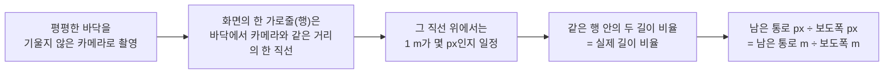
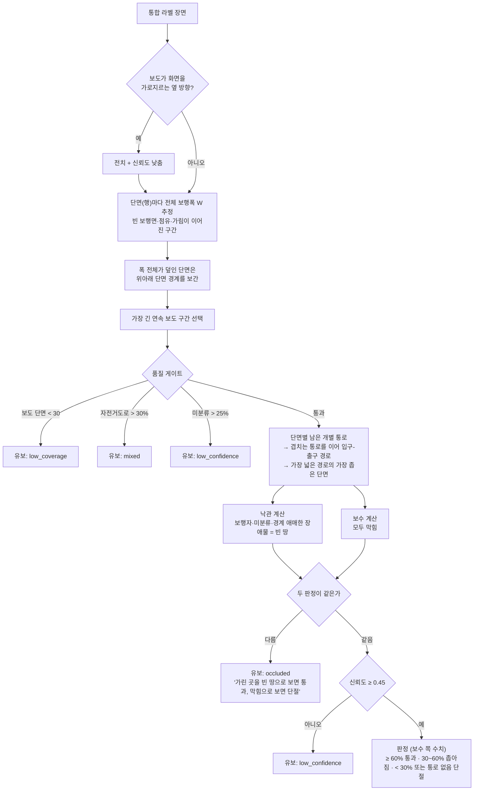
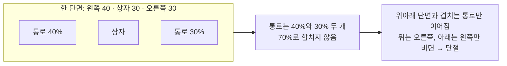

# 통과 여부·위험도 계산 (`app/ai_engine/passability/`)

마스터 문서 9장 팀 합의를 구현한 것입니다. 규칙 `rules-2026.10-b`, 정책 `policy-2026.10-draft`(보정 전 초안).
값이나 로직을 바꾸면 버전을 올려야 이전 분석과 비교할 수 있습니다.

## 1. 상대 수치와 절대 수치

| | 상대 수치 (기본) | 절대 수치 (선택, 보조) |
|---|---|---|
| 뜻 | 남은 연속 통로 ÷ 같은 단면의 전체 보행폭 (예: 45%) | 미터 (예: 1.1 m) |
| 사진 한 장으로 | **가능** (아래 2장) | 불가능. 사진만으로는 축척을 모름 |
| 판정(통과·좁아짐·단절) | **이것으로 함** | 쓰지 않음 |
| 상대 위험도 | **이것으로 함** | 쓰지 않음 |
| 응답 필드 | `bottleneck_ratio`, `occupancy`, `risk_score` | `bottleneck_m_est` (구간에 실측 보도폭이 있을 때만) |
| 근거 | 원 제안서(원근 오차 때문에 비율 중심), 답변서3(상대비율 기본), 마스터 문서 9장 | 마스터 문서 12장: 절대폭·GIS는 확장, 초기 MVP의 선행 조건 아님 |

사진 한 장에서는 축척을 알 수 없으므로 절대 수치는 판정·위험도에 쓰지 않고 참고값으로만 붙입니다.
같은 45%라도 2 m 보도의 45%(0.9 m)와 4 m 보도의 45%(1.8 m)는 다르며, 이 차이는 아래 절대 수치 출처로 보완합니다 (4장).

### 절대 수치 출처

| 출처 | 얻는 값 | 지금 상태 | 비고 |
|---|---|---|---|
| **현장 실측 (줄자)** | 구간의 전체 보도폭 | **구현됨** — `Site.sidewalk_width_m`에 넣으면 `상대폭 × 실측폭` | 10/23 현장 실측 때 같이 잴 수 있음. 가장 확실 |
| 사진 속 규격 물체 | 축척 (m/px) | 미구현 | 점자블록(규격 크기)·보도블록·연석이 같은 단면에 보이면 그 픽셀 폭으로 축척 계산 |
| 고정 CCTV 보정 | 바닥 좌표 변환(호모그래피) | 미구현 | 같은 화각을 반복 관측할 때 한 번만 바닥 4점을 실측 |
| 공공 데이터 | 보도폭 속성 | 미구현 | 서울 보도 데이터(Zenodo, 마스터 문서 7장)에 폭 속성이 있음. 지역이 한정되고 촬영 위치와 정합 필요. 연속수치지형도 도로폭은 **차도** 폭이라 보도폭이 아님 |
| 단안 깊이 추정 모델 + 카메라 정보 | 픽셀별 거리 → 축척 | 미구현 | 연구 단계. 오차 검증 없이 판정에 쓰면 안 됨 |
| 휴대폰 AR·LiDAR 측정 | 실제 거리 | 범위 밖 | 촬영 앱이 필요 |

## 2. 원근과 상대 폭 비율



- 가까운 행은 1 m = 200 px, 먼 행은 1 m = 40 px처럼 행마다 축척이 다르지만, **분자와 분모를 같은 행에서 재기 때문에 축척이 약분**됩니다.
  그래서 서로 다른 행의 픽셀 폭끼리는 절대 비교하지 않고, 행마다 비율로 바꾼 뒤에만 비교합니다.
- 보도를 비스듬히 찍어도(카메라가 보도 방향과 어긋나도) 한 행은 보도를 비스듬히 자르는 직선이 되고,
  전체 폭과 남은 폭이 **같은 각도로 같이 늘어나** 비율은 그대로입니다.
- 그래서 판정 기준(60%·30%)을 사진마다 바꾸지 않고 하나로 쓸 수 있습니다.

이 근사가 깨지는 조건이 곧 한계입니다 (4장).

## 3. 계산 단계

### 입력: 통합 라벨 장면

노면 semantic mask(보도·차도)에 차량·비차량 instance mask를 덮어 만든 H×W 라벨 지도.

| 값 | 라벨 | 규칙에서 |
|---|---|---|
| 1 | SIDEWALK | 빈 보행면 (보도 재질 병합, 점자블록) |
| 7 | BIKE_LANE | 빈 보행면 후보. 보도 범위의 30% 넘게 섞이면 **판단 유보(mixed)**. DeepLab class1(아스팔트·우레탄 보도 + 자전거도로)은 여기로 → 정상 보행면으로 전역 확정하지 않음 |
| 4 | OBSTACLE | 장애물 **전체 실루엣 = 점유 후보** (차량 문·창문·지붕 포함) |
| 5 | TRANSIENT | 보행자. 점유가 아니라 지면을 가리는 것 |
| 0 | UNKNOWN | 가림 취급. 보도 범위의 25% 넘으면 유보 |
| 2, 3, 6 | ROAD, CURB, BACKGROUND | 보도 범위의 끝. 상시 고정시설(가로수·가로등·전봇대·볼라드·벤치)은 BACKGROUND |

### 흐름



### 연속 통로 — 개별 통로를 합치지 않는다



- 경로의 값 = 지나는 단면들 중 가장 좁은 통로 비율 (병목). 이웃 단면 사이에서 통로가 겹친 폭도 병목 후보입니다.
- 입구에서 출구까지 가는 경로 중 병목이 가장 넓은 경로를 찾습니다 (max-min 경로).
- 보도 경계 끝이 장애물이고 그 너머가 연석·벽이 아니라 차도·화면 끝이면 "경계 애매"로 표시합니다
  (차도 위 차량이 보도를 가린 건지, 보도에 올라온 건지 모름 → 낙관·보수가 갈리면 유보).
- 작은 노면 오류를 morphology로 메우지 않습니다 (실제 차단까지 지워질 수 있음).

60%·30%는 **보정 전 가정값**입니다. 보정용 장소 실측으로 정하고 최종 평가 전에 고정합니다.

## 4. 한계와 극복 방법

| 한계 | 왜 생기나 | 지금 처리 | 극복 방법 (우선순위 순) |
|---|---|---|---|
| **같은 비율, 다른 실제 폭** (2 m 보도의 45% ≠ 4 m 보도의 45%) | 상대 수치는 축척이 없음 | 실측폭이 있으면 `bottleneck_m_est`를 덧붙임 | ① 현장 실측 구간에 보도폭 입력 ② 사진 속 점자블록·보도블록으로 축척 추정 ③ 고정 CCTV는 바닥 4점 보정 |
| **키 큰 물체 과대 차감** | 차량 지붕·입간판 윗부분이 화면상 더 먼 단면을 덮음 | 팀 합의대로 전체 실루엣 = 점유 (`footprint_frac=1.0`) | ① 현장 실측과 비교해 과대 정도 확인 ② `analyze_folder.py --footprint 0.4`처럼 아래쪽 접지부만 점유로 보는 설정과 혼동행렬 비교 ③ 효과가 확인되면 정책 버전을 올려 적용 |
| **카메라 기울어짐(roll)** | 가로줄이 바닥의 같은 거리 직선이 아니게 됨 | 처리 안 함 | ① 촬영 가이드: 수평 맞춰 찍기 ② 수평선·소실점으로 회전 보정 (추가 구현) |
| **옆 방향 사진** (보도가 화면을 가로지름) | 행이 같은 깊이가 아님 | 전치 + 신뢰도 0.8배, `stats.view = side` | 촬영 가이드: **보도 진행 방향을 바라보고** 찍기 |
| **경사·계단·턱** | 바닥이 평면이라는 가정이 깨짐 | 처리 안 함 | 해당 장면은 유보·검수 대상으로. 범위 밖 장면(보차혼용·산길)은 등록 단계에서 제외 |
| **보도 경계가 가려짐** | 차량·사람이 연석이나 건물 쪽 경계를 가림 | 양옆·인접 단면으로 추정, 갈리면 유보 | 다른 각도·시각에 한 장 더 찍어 같은 구간에 등록 (재관측) |
| **보도가 화면 밖으로 잘림** | 전체 보행폭 W를 작게 잡음 → 통과 쪽으로 치우침 | 처리 안 함 | 촬영 가이드: 보도 양쪽 끝(연석·건물선)이 모두 보이게 |
| **길이 항 측정 불가** | 사진 한 장은 구간 길이를 모름 | 위험도를 폭 항만으로 내고 `risk_complete=false` | 같은 구간을 여러 지점에서 찍어 단절 지점 수로 길이 비율 추정 / 영상 + 이동 기록 (확장) |
| **모델 오류** (보도 누락·건물 오탐·장애물 미탐) | 분할·탐지 모델의 한계 | 신뢰도·미분류 비율로 유보 | 파라미터로 숨기지 않고 모델 문제로 분리 → 미세조정·추가 라벨링 (마스터 문서 10장 2단계) |
| **우천 반사·야간** | 노면 인식 저하 | 저조도 + 유보면 사유를 `night`로 | 검수 대상. 낮·마른 날 재촬영 |

### 현장 촬영 기준

1. 보도 **진행 방향**을 바라보고, 눈높이에서, **수평**을 맞춰 찍는다
2. 보도 **양쪽 끝**(연석·건물선)이 화면에 다 들어오게 한다
3. 장애물 앞 3~10 m 정도에서 장애물과 그 너머 보도가 함께 보이게 한다
4. 휴대폰 위치 정보를 켜고 찍는다 (EXIF GPS·시각)
5. 보정용 장소에서는 전체 보도폭과 장애물 옆 남은 폭을 줄자로 재고, 사람이 통과·좁아짐·단절을 판정해 `labels.csv`에 적는다

## 5. 상대 위험도 (`risk.py`)

원 제안서 식: `R = w1 × (1 − 유효보행폭비율) + w2 × (단절길이 / 전체 분석길이)` → 0~100

- 유효보행폭비율 = 3장의 상대 유효폭
- **단일 사진은 길이 항을 정의할 수 없어 '측정 불가'(null)** 입니다. 원근이 다른 픽셀 행 수를 길이 비율로 쓰지 않습니다.
  이때 점수는 폭 항만 반영한 **부분 상대 지표**(`100 × (1 − 유효보행폭비율)`)이며 `risk_complete=false`로 표시합니다.
- 판단 유보는 점수 없음(null). 측정 불가를 0점으로 쓰지 않습니다.
- w1=0.7, w2=0.3은 초안. 길이 항을 정의하면 `risk_score(res, length_ratio=…)`로 반영합니다.
- 화면 표기는 **"상대 위험도"** 입니다.

## 6. 근거 (`analyses.evidence`)

- `reasons`: 화면에 그대로 보여줄 문장
- `stats`: 분석 단면 수, 미분류·자전거도로·가림·점유 비율, 경계 애매 비율, 덮인 단면 수, 낙관/보수 판정, 병목 단면, `view`, `narrow_row_fraction`(통과 기준 미만 픽셀 행 비율, 실제 길이 비율 아님)
- `risk`: 식·가중치·폭 항·길이 항·complete
- `quality`: 밝기·선명도·해상도
- 파일: `class_map.png`(통합 라벨) · `surface_overlay.jpg` · `obstacle_overlay.jpg`

## 7. 보정 (마스터 문서 10장 3단계)

```bash
python scripts/analyze_folder.py data/field/calib --labels data/field/calib/labels.csv --out outputs/calib_v1
python scripts/analyze_folder.py data/field/calib --labels … --pass-ratio 0.55 --block-ratio 0.25 --out outputs/calib_v2
python scripts/analyze_folder.py data/field/calib --labels … --footprint 0.4 --out outputs/calib_fp04
```
`labels.csv` 열: `file,label,sidewalk_width_m`. 현장 판정은 AI에 맞춰 고치지 않습니다.
가장 중요한 오류는 **단절·좁아짐을 통과로 놓친 것**입니다 (스크립트가 따로 셉니다).
최종 평가는 보정에 쓰지 않은 장소의 사진으로만 합니다.
