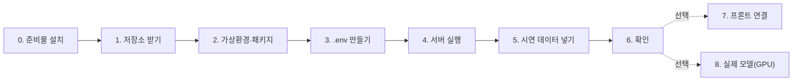

# 로컬 개발 환경 설정

로컬 PC에서 **백엔드 실행 → 시연 데이터 입력 → API 확인**까지의 순서입니다.
GPU·모델 가중치·DB 설치 없이 끝까지 됩니다 (기본값: SQLite + dummy 모델). 15분 정도 걸립니다.



## 0. 준비물

| 도구 | 버전 | 확인 명령 | 설치 |
|---|---|---|---|
| Git | 아무거나 | `git --version` | https://git-scm.com |
| Python | **3.12** (실제 모델 `roadpush_ai`는 3.12만. dummy만 쓸 때는 3.13 이상도 동작) | `python --version` | https://www.python.org/downloads/ (Windows: 설치 첫 화면에서 **Add python.exe to PATH** 체크) |
| VS Code | 선택 | | Python 확장 설치 |
| Node.js | **18 이상 필수** (LTS 권장), 프론트도 띄울 때 | `node --version` → `v18.x` 이상 | https://nodejs.org → **LTS** 버튼 (아래 참고) |

> **Node.js 설치 (18 이상)**: 프론트(Vite 5)는 Node 18 미만에서 설치·실행되지 않습니다.
> 1. https://nodejs.org 에서 **LTS** 버전(18 이상, 예: 20·22)을 내려받아 기본 옵션으로 설치합니다. npm도 함께 설치됩니다.
> 2. 열려 있던 터미널을 **모두 닫고 새로 열어** `node --version`, `npm --version`을 확인합니다.
> 3. 이미 설치돼 있는데 `v16.x` 이하로 나오면 같은 방법으로 LTS를 다시 설치합니다 (기존 버전 위에 덮어씀).

> Windows에서 `python`을 입력했는데 Microsoft Store가 열리면: 설정 → 앱 → 고급 앱 설정 → 앱 실행 별칭에서 `python.exe`, `python3.exe`를 끕니다.

## 1. 저장소 받기

```bash
git clone https://github.com/KingHaKyung/RoadPush_BE.git
cd RoadPush_BE
```

## 2. 가상환경과 패키지

**Windows (PowerShell)**
```powershell
python -m venv .venv
.venv\Scripts\Activate.ps1
python -m pip install --upgrade pip
pip install -e ".[dev]"
```
`Activate.ps1 ... 이 시스템에서 스크립트를 실행할 수 없으므로` 오류가 나면 한 번만 실행:
```powershell
Set-ExecutionPolicy -Scope CurrentUser RemoteSigned
```

**macOS · Linux**
```bash
python3 -m venv .venv
source .venv/bin/activate
python -m pip install --upgrade pip
pip install -e ".[dev]"
```

활성화되면 프롬프트 앞에 `(.venv)`가 붙습니다. **새 터미널을 열 때마다 활성화 명령을 다시 실행**해야 합니다.

## 3. .env 만들기

```powershell
copy .env.example .env      # Windows
```
```bash
cp .env.example .env        # macOS · Linux
```
기본값 그대로 두면 됩니다. `.env`는 Git에 올라가지 않습니다.

## 4. 서버 실행

```bash
uvicorn app.main:app --reload
```

아래처럼 나오면 성공입니다. 처음 실행할 때 `data/roadpush.db`(SQLite)와 테이블이 자동으로 만들어집니다.
```
INFO:alembic.runtime.migration:Running upgrade  -> 0001, 초기 스키마: 구간·관측·분석·검수·조치 …   ← 처음 한 번만
INFO:roadpush.worker:분석 워커 시작 (surface=dummy, obstacles=none)
INFO:     Application startup complete.
INFO:     Uvicorn running on http://127.0.0.1:8000 (Press CTRL+C to quit)
```

브라우저에서 확인:
- http://localhost:8000 → API 문서 화면(`/docs`)으로 이동
- http://localhost:8000/docs → 모든 API를 눌러 볼 수 있는 화면 (Swagger)
- http://localhost:8000/api/v1/health → `{"status":"ok", …}`

## 5. 시연 데이터 넣기

서버는 켜 둔 채 **터미널을 하나 더 열고**, 가상환경을 활성화한 뒤:
```bash
python scripts/seed_demo.py
```
구간 4곳, 관측 8건, 검수 1건, 조치 → 재촬영 전후 비교 1건이 들어갑니다. 여러 번 실행하면 그만큼 더 쌓입니다.

## 6. 확인

| 보고 싶은 것 | 주소 |
|---|---|
| 지도용 데이터 (구간별 최신 관측) | http://localhost:8000/api/v1/map |
| 관측 목록 | http://localhost:8000/api/v1/observations |
| 판단 유보만 | http://localhost:8000/api/v1/observations?passability=undetermined |
| 근거 이미지 | 응답의 `images.surface_overlay`, `images.obstacle_overlay` 주소를 브라우저에 붙여 넣기 |

`/docs` 화면의 **POST /api/v1/observations → Try it out**에서 자기 사진을 직접 올려 볼 수도 있습니다
(`captured_at`은 `2026-10-21T14:30:00+09:00` 형식, `new_site_name`에 아무 이름).

dummy 모델은 사진 내용을 보지 않고 가짜 장면을 만듭니다. 판정 결과는 흐름 확인용입니다.

처음부터 다시 하고 싶으면 서버를 끄고 `data/roadpush.db`와 `storage/` 폴더를 지운 뒤 다시 실행합니다.
DB 파일에는 참조 레이어(ref_*, 성남·서울 보도 폭)도 들어 있어 함께 지워집니다. 다시 넣으려면 [DB.md 6장](DB.md)의 `scripts/load_reference.py`를 실행합니다.

## 7. 프론트 연결 (선택)

프론트는 백엔드 폴더 **옆**(같은 상위 폴더)에 받습니다. 백엔드 폴더 안에서 `cd RoadPush_FE`를 하면 폴더가 없어 실패합니다.
```
C:\dev\
├─ RoadPush_BE\      ← 백엔드
└─ RoadPush_FE\      ← 프론트
```
1. Node.js 확인 — `node --version`이 **v18 이상**이어야 합니다. 없거나 낮으면 [0장](#0-준비물)의 Node.js 설치를 먼저 합니다.
2. 새 터미널(백엔드 서버 터미널과 별도)에서:
```powershell
cd C:\dev                    # RoadPush_BE가 있는 상위 폴더
git clone https://github.com/KingHaKyung/RoadPush_FE.git
cd RoadPush_FE
npm install
```
`added 74 packages …`가 나오면 성공입니다. 이어서 나오는 `2 vulnerabilities … npm audit fix --force`는 경고이며,
**`npm audit fix --force`는 실행하지 않습니다**. 설치가 안 되면 [TROUBLESHOOTING.md T7](TROUBLESHOOTING.md#t7-프론트-npm-install-실패-예방).
`RoadPush_FE/.env`:
```
VITE_API_BASE_URL=http://localhost:8000/api/v1
# 지도·CCTV 키 (VITE_ 접두사 없음 → 브라우저 코드에 안 들어가고 프론트 개발 서버 프록시만 씀)
VWORLD_KEY=<브이월드 인증키>
UTIC_API_KEY=<UTIC 개방데이터 키>
ITS_API_KEY=<ITS 국가교통정보센터 키>
```
UTIC는 신청할 때 등록한 IP 대역에서만 응답합니다. 등록한 IP의 PC(네트워크)에서 `npm run dev`를 실행해야 UTIC CCTV가 열립니다.
배포할 때는 같은 키를 백엔드 `.env`에 넣습니다 ([FRONTEND_INTEGRATION.md 5장](FRONTEND_INTEGRATION.md#5-배포테스트-url할-때)).
```bash
npm run dev     # http://localhost:5173
```
백엔드 연결 코드는 프론트 [PR #1](https://github.com/KingHaKyung/RoadPush_FE/pull/1)(`feat/api-connect`)에 있습니다. 합치기 전의 프론트 `main`은 `VITE_API_BASE_URL`과 관계없이 **예시 데이터 28건**으로 화면을 그립니다.
전체 테스트 순서는 [FRONTEND_INTEGRATION.md](FRONTEND_INTEGRATION.md)에 있습니다.
허용 출처는 `.env`의 `CORS_ORIGINS`입니다 (기본: `http://localhost:5173`, `https://road-push-fe.vercel.app`).

## 8. 실제 모델 실행 (RoadPush_AI 팀 파이프라인)

분석은 **RoadPush_AI 저장소의 코드를 그대로** 씁니다. 백엔드에는 모델·판정 규칙을 따로 두지 않습니다.

백엔드는 AI 저장소의 통합 진입점 `roadpush_ai.RoadPushAnalyzer` 하나를 호출하고
응답(`roadpush_analysis_response_v1`)을 소비합니다 (AI `docs/PRODUCTION_SYSTEM.md`).

| 단계 | AI 저장소 | 하는 일 |
|---|---|---|
| Phase 6 | `surface_passability` | Mask2Former(Mapillary) semantic → 보도·차도 후보 → 걸어갈 면 선택 |
| Phase 7-A | 〃 | 보행면 양쪽 경계 (직선 적합 → S1 연장 → 검증 → 등급) |
| Phase 7-B | 〃 | 끊기지 않는 연결 통로의 3행 병목 비율 (+ 보도 실폭이 있으면 m 단위) |
| 원인 | `roadpush_ai` (장애물 YOLO11s) | 최종 7-B 폭 계산에 쓴 점유와 겹치는 탐지만 원인 (차량·공사시설·적치물·PM → 처리 유형 A~D) |

백엔드 연결 코드: `app/ai_engine/roadpush.py`(RoadPushAnalyzer 호출), `causes.py`(원인 → 배지), `passability/phase7.py`(7-B 결과 → 판정).
판정 규칙과 AI 계약은 [PASSABILITY.md](PASSABILITY.md) 0장.

### 8-1. 폴더 배치

```
C:/dev/
  RoadPush_BE/                  이 저장소
  RoadPush_AI/                  src/roadpush_ai · surface_passability/src · configs/obstacle_detection.yaml
    models/                     (Git 제외, AI 팀 자산 묶음 v5 — 내용을 고치지 않음)
      model_assets.json                              모델 4종 SHA-256·폴더 hash
      surface_passability/semantic/                  Mask2Former Swin-L Mapillary (.cache 포함 그대로)
      surface_passability/yolo11n-seg.pt             7-B 차량 instance
      surface_passability/occupancy_evidence_v2/     승인된 7-B 점유 근거 (회귀 표본 3장, AI가 hash 일치 때만 사용)
      obstacle_detection/obstacle_yolo11s_full_os4.pt 장애물 원인
    experiments/                (선택, Git 제외) 전체 회귀·시각화 자료. 서비스 실행에는 필요 없음
```
다른 위치에 두면 `.env`의 `ROADPUSH_AI_ROOT`(저장소), `ROADPUSH_MODEL_ROOT`(모델 폴더)를 바꿉니다.
`python scripts/check_model.py`가 AI 검증기(`roadpush_ai.assets`)로 `models/model_assets.json`의 SHA-256·폴더 hash를 대조합니다.
`semantic/.cache`도 모델 hash에 들어가므로 지우지 않습니다. 장애물 가중치 SHA-256은 분석기를 만들 때도 확인합니다(`configs/obstacle_detection.yaml`).

### 8-2. Python 3.12 가상환경과 패키지

`roadpush_ai`는 **Python 3.12만** 지원합니다 (AI `pyproject.toml`). dummy로만 개발하던 다른 버전 가상환경과 따로 만듭니다.

> **CUDA Toolkit·cuDNN은 따로 설치하지 않아도 됩니다.** pip로 받는 PyTorch에 CUDA 실행 파일이 들어 있어
> 필요한 것은 **NVIDIA 그래픽 드라이버**뿐입니다 (CUDA 12.8 빌드 → Windows 드라이버 570.65 이상).

```powershell
cd C:\dev\RoadPush_BE
py -3.12 -m venv .venv312
.venv312\Scripts\Activate.ps1
python -m pip install -U pip
# torch·torchvision을 먼저 같은 명령으로 (AI 저장소 requirements/torch-*.txt와 같은 버전)
pip install torch==2.7.1 torchvision==0.22.1 --index-url https://download.pytorch.org/whl/cpu     # CPU
# pip install torch==2.7.1 torchvision==0.22.1 --index-url https://download.pytorch.org/whl/cu128  # GPU
pip install -e ".[ai,dev]"
# 선택: 안 하면 ROADPUSH_AI_ROOT의 src·surface_passability/src를 찾아 쓴다
pip install -e ..\RoadPush_AI --no-deps
pip install -e ..\RoadPush_AI\surface_passability --no-deps
```
`py` 런처가 없으면 [uv](https://docs.astral.sh/uv/)로 같은 환경을 만듭니다 (Python 3.12도 uv가 받아 줌):
```powershell
uv python install 3.12
uv venv .venv312 --python 3.12
uv pip install --python .venv312\Scripts\python.exe torch==2.7.1 torchvision==0.22.1 --index-url https://download.pytorch.org/whl/cu128
uv pip install --python .venv312\Scripts\python.exe -e ".[ai,dev]"
uv pip install --python .venv312\Scripts\python.exe -e ..\RoadPush_AI --no-deps
uv pip install --python .venv312\Scripts\python.exe -e ..\RoadPush_AI\surface_passability --no-deps
```

### 8-3. .env

```
ANALYSIS_ENGINE=roadpush_ai
ROADPUSH_AI_ROOT=../RoadPush_AI
# ROADPUSH_MODEL_ROOT=     # 모델 폴더를 다른 곳에 두면 (기본: ROADPUSH_AI_ROOT/models)
SEMANTIC_DEVICE=cpu        # AI 팀 결과 재현 기준. cuda는 빠르지만 결과가 조금 달라질 수 있음
DEVICE=auto                # 장애물 원인 모델: GPU가 있으면 GPU
# AGENT_WIDTH_M=0.9        # 선택: 구간 보도 폭이 있을 때 m 단위 판정 (없으면 상대폭 기준)
# SAFETY_FACTOR=1.2
```
- 장애물 원인 모델은 통합 파이프라인의 일부라 따로 끌 수 없습니다. 모델 파일이 하나라도 없거나 SHA-256이 다르면
  분석을 실패로 남깁니다 (원인 없이 조용히 넘어가지 않게). 장애물 단계만 실패하면(AI `status=partial`) 실행 오류로 재시도합니다.
- 7-B의 차량 instance 모델(YOLO11n-seg)은 AI production 검증대로 CPU에서 돕니다 (`ROADPUSH_YOLO_DEVICE=cpu`를 백엔드가 기본으로 넣음).
- semantic 캐시는 `STORAGE_DIR/ai/semantic_cache`에 둡니다 (사진 hash·모델 identity가 key). 같은 사진을 재분석하면 추론을 다시 하지 않습니다.
- 걸리는 시간: AI 팀 측정(RTX 5070 Ti Laptop, 160장) 사진 1장 평균 GPU 2.3초 · CPU 3.4초. 첫 사진은 모델을 올리느라 더 걸립니다.
  분석은 워커 큐로 돌아서 화면은 "AI 분석 대기 중"을 보이다가 결과로 바뀝니다.

### 8-4. 점검

```powershell
python scripts/check_model.py              # 설치·모델 파일·장애물 클래스 → 원인 배지
python scripts/check_model.py 보도사진.jpg  # 사진 1장 RoadPushAnalyzer → 판정·원인 (outputs/check_model/<사진>/)
```
`evidence.json`에 7-B 기록 전체(`phase7_b_result_v2`)와 원인(`cause`)이, `obstacle_overlay.jpg`에 연결 통로·병목·원인 박스가 나옵니다.
여러 장은 `python scripts/analyze_folder.py <폴더> --labels labels.csv --out outputs/x` (사진별 7-B 기록은 `phase7b.jsonl`).

## 9. 테스트

```bash
pytest
ruff check app tests scripts migrations
```
코드를 고친 뒤 푸시하기 전에 두 명령이 통과하는지 확인합니다.

## 10. DB 사용 규칙

- **로컬 개발은 각자 SQLite(기본값)** 를 씁니다. 자기 PC의 `.env`에 Supabase 주소를 넣지 마세요.
  사진 파일은 각자 PC의 `storage/`에 저장되기 때문에, 공용 DB를 여러 PC가 같이 쓰면 서로의 이미지가 깨집니다 ([DB.md](DB.md) 1장).
- Supabase는 **배포 서버만** 연결합니다. 팀원이 같은 데이터를 보려면 배포 서버 주소를 씁니다.
- 테이블 구조 변경은 백엔드 담당이 Alembic 마이그레이션으로만 합니다 ([DB.md](DB.md) 5장). `git pull` 후 서버를 켜면 자동 적용됩니다.
- 지금 연결된 DB 상태 확인: `python scripts/check_db.py` (연결·마이그레이션·테이블·RLS)
- **Supabase 프로젝트 생성·연결(백엔드 담당)** 은 [DB.md 2장](DB.md#2-supabase-연결-순서)의 순서를 따릅니다.

## 11. Git 협업

```bash
git checkout main && git pull                 # 최신 받기
git checkout -b feat/짧은-설명                 # 작업 브랜치
# … 작업 …
pytest && ruff check app tests scripts migrations
git add -A && git commit -m "무엇을 왜 바꿨는지"
git push -u origin feat/짧은-설명              # GitHub에서 main으로 Pull Request
```
올리면 안 되는 것: `.env`, `storage/`, `model_weights/`의 가중치, `data/`의 학습 자료, `outputs/` (이미 `.gitignore`에 있음).

## 12. 자주 나는 문제

원인과 해결 과정은 [TROUBLESHOOTING.md](TROUBLESHOOTING.md)에 기록합니다.

| 증상 | 해결 |
|---|---|
| 프론트 `npm install` 실패 | `node --version`이 **v18 이상**인지, 프론트를 백엔드 폴더 **옆**에 받았는지 확인 ([T7](TROUBLESHOOTING.md#t7-프론트-npm-install-실패-예방)) |
| `npm audit fix --force` 하라는 경고 | 설치는 성공. 실행하지 않음 |
| `UnicodeDecodeError: 'cp949' codec …` (서버 시작 시) | `git pull`로 최신 코드 받기 ([T5](TROUBLESHOOTING.md#t5-uvicorn-실행-시-unicodedecodeerror-cp949)). 로컬에서 `alembic.ini`를 고쳤다면 `git checkout -- alembic.ini` 후 `git pull` |
| `{"detail":"Not Found"}` | 주소 뒤에 `/docs` 또는 `/api/v1/health`를 붙여 접속. 최신 코드는 `/`에서 `/docs`로 자동 이동 ([T6](TROUBLESHOOTING.md#t6-서버-주소로-접속하면-detailnot-found)) |
| 로그의 한글이 깨져 보임 | 표시 문제일 뿐 동작은 정상. Windows Terminal 사용 또는 실행 전 `chcp 65001` |
| 모든 분석이 "이미지를 읽을 수 없습니다"로 실패 | 최신 코드는 한글 경로 지원. 영상에서 계속 실패하면 프로젝트를 `C:\dev\RoadPush_BE` 같은 영문 경로로 이동 ([T3](TROUBLESHOOTING.md#t3-한글이-들어간-폴더에서-이미지를-못-읽는-문제)) |
| `uvicorn`을 찾을 수 없음 | 가상환경 활성화 안 됨 → 2장의 활성화 명령 |
| `ModuleNotFoundError: app` | 저장소 폴더(`RoadPush_BE`) 안에서 실행했는지 확인 |
| `address already in use` / 포트 사용 중 | 다른 서버가 8000번 사용 중 → `uvicorn app.main:app --reload --port 8001` |
| 프론트에서 CORS 오류 | `.env`의 `CORS_ORIGINS`에 프론트 주소 추가 후 서버 재시작 |
| 관측이 계속 `pending` | 워커가 안 돌고 있음 → `.env`의 `RUN_WORKER_IN_API=true` 확인, 서버 로그의 "분석 워커 시작" 확인 |
| 관측이 `failed` | `GET /api/v1/observations/{id}/analyses`의 `error` 확인. `input`이면 사진 파일 문제 |
| `422 구간을 확인해 주세요` | 등록할 때 `site_id`(기존 구간) 또는 `new_site_name`(신규 구간) 중 하나 필요 |
| `422 captured_at에 시간대` | `2026-10-21T14:30:00+09:00`처럼 `+09:00` 붙이기 |
| 실제 모델에서 `torch`·`roadpush_ai` 없음 | Python 3.12 가상환경인지 확인 → [8-2](#8-2-python-312-가상환경과-패키지), `python scripts/check_model.py` |
| `torch.cuda.is_available()`이 False | CPU용 torch가 깔림 → `pip uninstall torch` 후 CUDA용 명령으로 다시 설치 |
| 분석이 `ModelMissing`으로 실패 | AI 저장소 `models/`에 모델 파일이 없음 또는 SHA-256 불일치 (`python scripts/check_model.py`) → [8-1](#8-1-폴더-배치) |
| DB를 초기화하고 싶음 | 서버 끄고 `data/roadpush.db`, `storage/` 삭제 (참조 레이어도 지워지므로 `scripts/load_reference.py`로 다시 넣기) |
