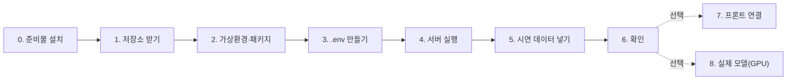

# 로컬 개발 환경 설정

로컬 PC에서 **백엔드 실행 → 시연 데이터 입력 → API 확인**까지의 순서입니다.
GPU·모델 가중치·DB 설치 없이 끝까지 됩니다 (기본값: SQLite + dummy 모델). 15분 정도 걸립니다.



## 0. 준비물

| 도구 | 버전 | 확인 명령 | 설치 |
|---|---|---|---|
| Git | 아무거나 | `git --version` | https://git-scm.com |
| Python | **3.11 또는 3.12 권장** (3.13도 기본 기능은 동작) | `python --version` | https://www.python.org/downloads/ (Windows: 설치 첫 화면에서 **Add python.exe to PATH** 체크) |
| VS Code | 선택 | | Python 확장 설치 |
| Node.js | 18 이상, 프론트도 띄울 때만 | `node --version` | https://nodejs.org |

> Windows에서 `python`을 입력했는데 Microsoft Store가 열리면: 설정 → 앱 → 고급 앱 설정 → 앱 실행 별칭에서 `python.exe`, `python3.exe`를 끕니다.

## 1. 저장소 받기

```bash
git clone https://github.com/KingHaKyung/RoadPush_BE.git
cd RoadPush_BE
```

## 2. 가상환경과 패키지

**Windows (PowerShell)**
```powershell
python -m venv .venv
.venv\Scripts\Activate.ps1
python -m pip install --upgrade pip
pip install -e ".[dev]"
```
`Activate.ps1 ... 이 시스템에서 스크립트를 실행할 수 없으므로` 오류가 나면 한 번만 실행:
```powershell
Set-ExecutionPolicy -Scope CurrentUser RemoteSigned
```

**macOS · Linux**
```bash
python3 -m venv .venv
source .venv/bin/activate
python -m pip install --upgrade pip
pip install -e ".[dev]"
```

활성화되면 프롬프트 앞에 `(.venv)`가 붙습니다. **새 터미널을 열 때마다 활성화 명령을 다시 실행**해야 합니다.

## 3. .env 만들기

```powershell
copy .env.example .env      # Windows
```
```bash
cp .env.example .env        # macOS · Linux
```
기본값 그대로 두면 됩니다. `.env`는 Git에 올라가지 않습니다.

## 4. 서버 실행

```bash
uvicorn app.main:app --reload
```

아래처럼 나오면 성공입니다. 처음 실행할 때 `roadpush.db`(SQLite)와 테이블이 자동으로 만들어집니다.
```
INFO:alembic.runtime.migration:Running upgrade  -> 0001, 초기 스키마: 구간·관측·분석·검수·조치 …   ← 처음 한 번만
INFO:roadpush.worker:분석 워커 시작 (surface=dummy, obstacles=none)
INFO:     Application startup complete.
INFO:     Uvicorn running on http://127.0.0.1:8000 (Press CTRL+C to quit)
```

브라우저에서 확인:
- http://localhost:8000 → API 문서 화면(`/docs`)으로 이동
- http://localhost:8000/docs → 모든 API를 눌러 볼 수 있는 화면 (Swagger)
- http://localhost:8000/api/v1/health → `{"status":"ok", …}`

## 5. 시연 데이터 넣기

서버는 켜 둔 채 **터미널을 하나 더 열고**, 가상환경을 활성화한 뒤:
```bash
python scripts/seed_demo.py
```
구간 4곳, 관측 8건, 검수 1건, 조치 → 재촬영 전후 비교 1건이 들어갑니다. 여러 번 실행하면 그만큼 더 쌓입니다.

## 6. 확인

| 보고 싶은 것 | 주소 |
|---|---|
| 지도용 데이터 (구간별 최신 관측) | http://localhost:8000/api/v1/map |
| 관측 목록 | http://localhost:8000/api/v1/observations |
| 판단 유보만 | http://localhost:8000/api/v1/observations?passability=undetermined |
| 근거 이미지 | 응답의 `images.surface_overlay`, `images.obstacle_overlay` 주소를 브라우저에 붙여 넣기 |

`/docs` 화면의 **POST /api/v1/observations → Try it out**에서 자기 사진을 직접 올려 볼 수도 있습니다
(`captured_at`은 `2026-10-21T14:30:00+09:00` 형식, `new_site_name`에 아무 이름).

dummy 모델은 사진 내용을 보지 않고 가짜 장면을 만듭니다. 판정 결과는 흐름 확인용입니다.

처음부터 다시 하고 싶으면 서버를 끄고 `roadpush.db`와 `storage/` 폴더를 지운 뒤 다시 실행합니다.

## 7. 프론트 연결 (선택)

프론트는 백엔드 폴더 **옆**(같은 상위 폴더)에 받습니다. 백엔드 폴더 안에서 `cd RoadPush_FE`를 하면 폴더가 없어 실패합니다.
```
C:\dev\
├─ RoadPush_BE\      ← 백엔드
└─ RoadPush_FE\      ← 프론트
```
1. Node.js 확인 — `node --version`이 **v18 이상**이어야 합니다. 없으면 https://nodejs.org 에서 LTS 설치 후 터미널을 새로 엽니다.
2. 새 터미널(백엔드 서버 터미널과 별도)에서:
```powershell
cd C:\dev                    # RoadPush_BE가 있는 상위 폴더
git clone https://github.com/KingHaKyung/RoadPush_FE.git
cd RoadPush_FE
npm install
```
`added 74 packages …`가 나오면 성공입니다. 이어서 나오는 `2 vulnerabilities … npm audit fix --force`는 경고이며,
**`npm audit fix --force`는 실행하지 않습니다**. 설치가 안 되면 [TROUBLESHOOTING.md T7](TROUBLESHOOTING.md#t7-프론트-npm-install이-안-됨).
`RoadPush_FE/.env`:
```
VITE_API_BASE_URL=http://localhost:8000/api/v1
```
```bash
npm run dev     # http://localhost:5173
```
지금 프론트는 **예시 데이터 20건**으로 화면을 그립니다. `VITE_API_BASE_URL`을 넣어도 백엔드 데이터가 바로 보이지는 않고,
프론트의 `src/lib/useObservations.ts`에서 API를 부르는 연결 코드가 들어가야 합니다 (필드 매핑은 [API.md](API.md) 마지막 표).
허용 출처는 `.env`의 `CORS_ORIGINS`입니다 (기본: `http://localhost:5173`, `https://road-push-fe.vercel.app`).

## 8. 실제 모델 실행 (GPU 환경)

1. CUDA용 PyTorch 설치 — https://pytorch.org/get-started/locally/ 에서 OS·CUDA를 고르고 나온 명령을 그대로 씁니다. 예:
   ```bash
   pip install torch --index-url https://download.pytorch.org/whl/cu124
   ```
2. 모델 라이브러리
   ```bash
   pip install -e ".[ml]"
   ```
3. 가중치 파일을 `model_weights/`에 넣기 ([model_weights/README.md](../model_weights/README.md))
4. `.env` 수정 후 서버 재시작
   ```
   SURFACE_MODEL=selectstar
   OBSTACLE_MODEL=yolo
   OBSTACLE_WEIGHTS=["model_weights/yolo11n-seg.pt"]
   DEVICE=cuda
   ```
5. GPU 확인: `python -c "import torch; print(torch.cuda.is_available())"` → `True`

서버 없이 사진 폴더만 분석하려면:
```bash
python scripts/analyze_folder.py <사진 폴더> --out outputs/test1
```

## 9. 테스트

```bash
pytest
ruff check app tests scripts migrations
```
코드를 고친 뒤 푸시하기 전에 두 명령이 통과하는지 확인합니다.

## 10. DB 사용 규칙

- **로컬 개발은 각자 SQLite(기본값)** 를 씁니다. 자기 PC의 `.env`에 Supabase 주소를 넣지 마세요.
  사진 파일은 각자 PC의 `storage/`에 저장되기 때문에, 공용 DB를 여러 PC가 같이 쓰면 서로의 이미지가 깨집니다 ([DB.md](DB.md) 1장).
- Supabase는 **배포 서버만** 연결합니다. 팀원이 같은 데이터를 보려면 배포 서버 주소를 씁니다.
- 테이블 구조 변경은 백엔드 담당이 Alembic 마이그레이션으로만 합니다 ([DB.md](DB.md) 5장). `git pull` 후 서버를 켜면 자동 적용됩니다.
- 지금 연결된 DB 상태 확인: `python scripts/check_db.py` (연결·마이그레이션·테이블·RLS)
- **Supabase 프로젝트 생성·연결(백엔드 담당)** 은 [DB.md 2장](DB.md#2-supabase-연결-순서)의 순서를 따릅니다.

## 11. Git 협업

```bash
git checkout main && git pull                 # 최신 받기
git checkout -b feat/짧은-설명                 # 작업 브랜치
# … 작업 …
pytest && ruff check app tests scripts migrations
git add -A && git commit -m "무엇을 왜 바꿨는지"
git push -u origin feat/짧은-설명              # GitHub에서 main으로 Pull Request
```
올리면 안 되는 것: `.env`, `storage/`, `model_weights/`의 가중치, `data/`의 학습 자료, `outputs/` (이미 `.gitignore`에 있음).

## 12. 자주 나는 문제

원인과 해결 과정은 [TROUBLESHOOTING.md](TROUBLESHOOTING.md)에 기록합니다.

| 증상 | 해결 |
|---|---|
| 프론트 `npm install` 실패 | 프론트를 백엔드 폴더 **옆**에 받았는지, `node --version`이 v18 이상인지 확인 ([T7](TROUBLESHOOTING.md#t7-프론트-npm-install이-안-됨)) |
| `npm audit fix --force` 하라는 경고 | 설치는 성공. 실행하지 않음 |
| `UnicodeDecodeError: 'cp949' codec …` (서버 시작 시) | `git pull`로 최신 코드 받기 ([T5](TROUBLESHOOTING.md#t5-uvicorn-실행-시-unicodedecodeerror-cp949)). 로컬에서 `alembic.ini`를 고쳤다면 `git checkout -- alembic.ini` 후 `git pull` |
| `{"detail":"Not Found"}` | 주소 뒤에 `/docs` 또는 `/api/v1/health`를 붙여 접속. 최신 코드는 `/`에서 `/docs`로 자동 이동 ([T6](TROUBLESHOOTING.md#t6-서버-주소로-접속하면-detailnot-found)) |
| 로그의 한글이 깨져 보임 | 표시 문제일 뿐 동작은 정상. Windows Terminal 사용 또는 실행 전 `chcp 65001` |
| 모든 분석이 "이미지를 읽을 수 없습니다"로 실패 | 최신 코드는 한글 경로 지원. 영상에서 계속 실패하면 프로젝트를 `C:\dev\RoadPush_BE` 같은 영문 경로로 이동 ([T3](TROUBLESHOOTING.md#t3-한글이-들어간-폴더에서-이미지를-못-읽는-문제)) |
| `uvicorn`을 찾을 수 없음 | 가상환경 활성화 안 됨 → 2장의 활성화 명령 |
| `ModuleNotFoundError: app` | 저장소 폴더(`RoadPush_BE`) 안에서 실행했는지 확인 |
| `address already in use` / 포트 사용 중 | 다른 서버가 8000번 사용 중 → `uvicorn app.main:app --reload --port 8001` |
| 프론트에서 CORS 오류 | `.env`의 `CORS_ORIGINS`에 프론트 주소 추가 후 서버 재시작 |
| 관측이 계속 `pending` | 워커가 안 돌고 있음 → `.env`의 `RUN_WORKER_IN_API=true` 확인, 서버 로그의 "분석 워커 시작" 확인 |
| 관측이 `failed` | `GET /api/v1/observations/{id}/analyses`의 `error` 확인. `input`이면 사진 파일 문제 |
| `422 구간을 확인해 주세요` | 등록할 때 `site_id`(기존 구간) 또는 `new_site_name`(신규 구간) 중 하나 필요 |
| `422 captured_at에 시간대` | `2026-10-21T14:30:00+09:00`처럼 `+09:00` 붙이기 |
| 실제 모델에서 `torch` 없음 | 8장 1~2번 |
| `torch.cuda.is_available()`이 False | CPU용 torch가 깔림 → `pip uninstall torch` 후 CUDA용 명령으로 다시 설치 |
| DB를 초기화하고 싶음 | 서버 끄고 `roadpush.db`, `storage/` 삭제 |
