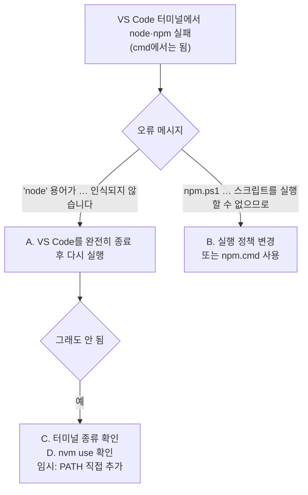
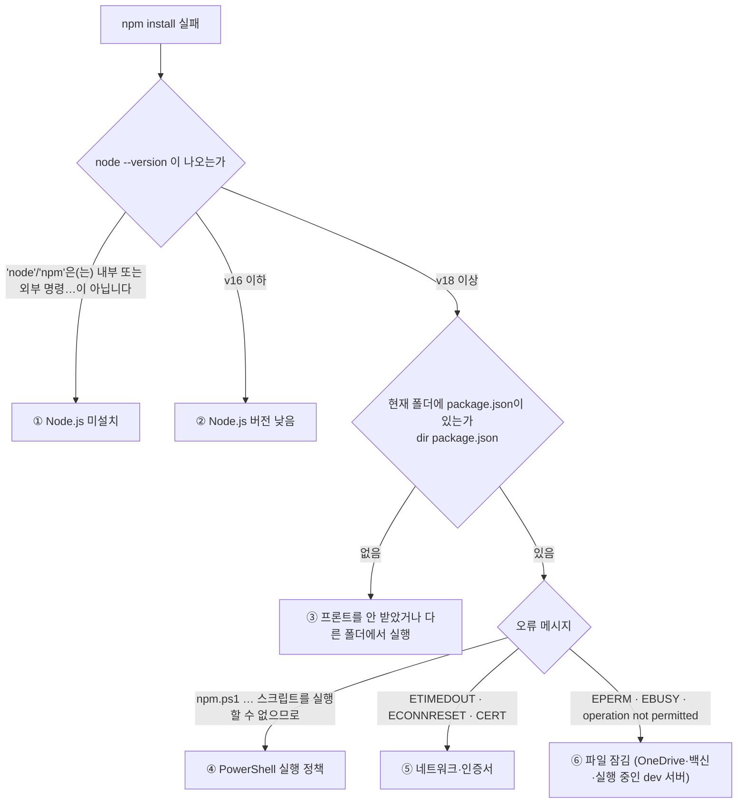

# 트러블슈팅 기록

실행·개발 중 발생한 문제와 원인, 해결, 재발 방지를 기록합니다. 최신 항목이 위에 옵니다.
증상별 빠른 해결은 [SETUP.md 12장](SETUP.md#12-자주-나는-문제)에도 있습니다.

| # | 날짜 | 환경 | 증상 | 상태 |
|---|---|---|---|---|
| [T8](#t8-명령-프롬프트에서는-node가-되는데-vs-code-터미널에서는-안-됨) | 10/22 | Windows · VS Code | cmd에서는 `node`가 되는데 VS Code 터미널에서는 찾을 수 없음, `npm install` 실패 | 해결 방법 안내 |
| [T7](#t7-프론트-npm-install-실패-예방) | 10/22 | Windows | 프론트 `npm install` 실패 가능성 (Node 버전·실행 위치 등) | 예방 조치 |
| [T6](#t6-서버-주소로-접속하면-detailnot-found) | 10/21 | 전체 | `http://127.0.0.1:8000` 접속 시 `{"detail":"Not Found"}` | 해결 |
| [T5](#t5-uvicorn-실행-시-unicodedecodeerror-cp949) | 10/21 | Windows (한국어) | `uvicorn` 실행 시 `UnicodeDecodeError: 'cp949' codec …` | 해결 |
| [T4](#t4-env-한글-주석을-cp949로-읽는-문제) | 10/21 | Windows (한국어) | `.env` 한글 주석을 cp949로 읽어 값이 깨질 수 있음 | 예방 조치 |
| [T3](#t3-한글이-들어간-폴더에서-이미지를-못-읽는-문제) | 10/21 | Windows | 폴더 경로에 한글이 있으면 OpenCV가 사진을 못 읽음 | 예방 조치 |
| [T2](#t2-촬영시각이-9시간-어긋남) | 10/21 | SQLite | 촬영시각 `+09:00`이 사라져 9시간 어긋남 | 해결 |
| [T1](#t1-보도-폭-전체가-막힌-구간이-통과로-나옴) | 10/21 | 판정 규칙 | 폭 전체가 막힌 구간이 분석에서 빠져 "통과"로 나옴 | 해결 |

---

## T8. 명령 프롬프트에서는 node가 되는데 VS Code 터미널에서는 안 됨

**증상** Windows 명령 프롬프트(cmd)에서는 `node --version`이 나오는데, VS Code 터미널에서는 아래처럼 찾을 수 없다고 나오고 `npm install`도 실패함.
```
node : 'node' 용어가 cmdlet, 함수, 스크립트 파일 또는 실행할 수 있는 프로그램 이름으로 인식되지 않습니다.
```
또는 `node`는 되는데 `npm`만 실패함.
```
npm : 이 시스템에서 스크립트를 실행할 수 없으므로 C:\Program Files\nodejs\npm.ps1 파일을 로드할 수 없습니다.
```

**원인** Node.js 자체는 정상 설치돼 있고, VS Code 터미널 환경만 다릅니다.

| 원인 | 설명 |
|---|---|
| A. VS Code를 Node 설치 **전에** 켜 둠 (가장 흔함) | 터미널은 VS Code가 켜질 때의 PATH(프로그램 경로 목록)를 물려받습니다. Node 설치 후 VS Code 안에서 터미널만 새로 열면 예전 PATH 그대로라 `node`를 못 찾습니다 |
| B. PowerShell 실행 정책 | VS Code 기본 터미널은 PowerShell이고, `npm`은 PowerShell에서 `npm.ps1` 스크립트로 실행됩니다. 스크립트 실행이 막혀 있으면 `npm`만 실패합니다. cmd는 `npm.cmd`를 써서 영향이 없습니다 |
| C. 터미널 종류가 다름 | VS Code 터미널이 Git Bash·WSL 등으로 설정돼 있으면 Windows용 Node 경로를 못 볼 수 있습니다 |
| D. nvm-windows로 설치 | 버전을 선택(`nvm use`)하지 않았거나 다른 창에서만 선택된 상태 |

**원인 찾기**



**해결**

1. **VS Code를 완전히 종료한 뒤 다시 실행** (원인 A)
   - 열려 있는 VS Code 창을 **모두** 닫습니다. 창 하나만 닫거나 "Reload Window"로는 PATH가 바뀌지 않습니다.
   - 작업 관리자(`Ctrl+Shift+Esc`)에 `Code.exe`(Visual Studio Code)가 남아 있으면 끝냅니다.
   - 다시 열고 **새 터미널**에서 `node --version`을 확인합니다. 그래도 안 되면 PC를 재시작합니다.

2. **`npm.ps1 … 로드할 수 없습니다`일 때** (원인 B) — 둘 중 하나
   ```powershell
   Set-ExecutionPolicy -Scope CurrentUser RemoteSigned    # 한 번만 실행 (Y 입력)
   ```
   또는 정책을 바꾸지 않고 `npm.cmd install`, `npm.cmd run dev`처럼 `.cmd`를 붙여 실행합니다.

3. **터미널 종류 확인** (원인 C)
   VS Code 터미널 오른쪽 위 `+` 옆 `∨` → **Select Default Profile** → `PowerShell` 또는 `Command Prompt` 선택 → 새 터미널.

4. **nvm-windows를 쓰는 경우** (원인 D)
   ```powershell
   nvm list           # 설치된 버전
   nvm use 22.11.0    # 목록에 있는 18 이상 버전 선택 (예시)
   ```

5. **임시 해결 — 지금 터미널에만 경로 추가**
   cmd에서 Node 위치를 확인합니다.
   ```
   where node
   ```
   보통 `C:\Program Files\nodejs\node.exe`입니다. VS Code PowerShell에서 그 폴더를 PATH에 추가합니다.
   ```powershell
   $env:Path += ";C:\Program Files\nodejs"
   node --version
   ```
   이 터미널을 닫으면 사라지므로, 1번(VS Code 재시작)으로 근본 해결합니다.

**확인 명령** (VS Code PowerShell)
```powershell
Get-Command node, npm               # 실제로 실행되는 파일 경로
$env:Path -split ';' | Select-String nodejs   # PATH에 Node 폴더가 있는지
Get-ExecutionPolicy -List           # 실행 정책 (CurrentUser가 RemoteSigned면 정상)
```

**예방 조치** [SETUP.md 0장](SETUP.md#0-준비물)에 "Node 설치 후 VS Code 완전히 재시작" 안내 추가, [12장](SETUP.md#12-자주-나는-문제) 표에 증상 추가.

---

## T7. 프론트 `npm install` 실패 예방

**증상 (예방)** 프론트 연결 준비 중 `npm install`이 실패할 수 있는 경우를 미리 정리했습니다. 실제 오류가 발생한 기록은 아닙니다.

**확인한 것** 프론트 저장소(`main`, 21b5ed1)를 Node 22 / npm 10에서 새로 받아 `npm install`하면 74개 패키지가 5초 만에 설치되고
`npm run build`도 통과합니다. 설치가 실패한다면 프론트 코드가 아니라 PC 환경·실행 위치 문제입니다.
가장 흔한 원인은 **Node.js 버전(18 미만)** 과 **실행 위치(백엔드 폴더 안)** 입니다.

**원인 찾기** 오류 메시지의 첫 줄로 아래 표에서 찾습니다.



| # | 오류 메시지 (첫 줄) | 원인 | 해결 |
|---|---|---|---|
| ① | `'npm'은(는) 내부 또는 외부 명령, 실행할 수 있는 프로그램, 또는 배치 파일이 아닙니다` / `npm : 'npm' 용어가 cmdlet … 인식되지 않습니다` | Node.js가 없음 | https://nodejs.org 에서 **LTS** 설치 → **터미널을 닫았다 다시 열기** → `node --version` |
| ② | `Unsupported engine` / Vite 실행 시 문법 오류 | Node 16 이하 (Vite 5는 18 이상 필요) | Node LTS 재설치 |
| ③ | `cd : 'RoadPush_FE' 경로를 찾을 수 없습니다` 또는 `npm error enoent … package.json` | 프론트 저장소를 받지 않았거나, 백엔드 폴더 안에서 `cd RoadPush_FE`를 실행 | 백엔드와 **나란히 있는 폴더**에 받기 (아래 "올바른 폴더 배치") |
| ④ | `npm.ps1 파일을 로드할 수 없습니다 … 이 시스템에서 스크립트를 실행할 수 없으므로` | PowerShell 실행 정책 | `Set-ExecutionPolicy -Scope CurrentUser RemoteSigned` 한 번 실행, 또는 `npm.cmd install` |
| ⑤ | `ETIMEDOUT`, `ECONNRESET`, `UNABLE_TO_GET_ISSUER_CERT_LOCALLY`, `SELF_SIGNED_CERT_IN_CHAIN` | 학교·회사 네트워크의 방화벽·보안 프록시 | 휴대폰 핫스팟 등 다른 네트워크에서 다시 실행. 인증서 검사를 끄는 설정(`strict-ssl false`)은 쓰지 않음 |
| ⑥ | `EPERM`, `EBUSY`, `operation not permitted` | OneDrive 동기화 폴더·백신·켜져 있는 `npm run dev`가 파일을 잡고 있음 | dev 서버 끄기 → `node_modules` 폴더 삭제 → 다시 `npm install`. OneDrive 폴더(문서·바탕 화면) 밖으로 옮기기 |

**실패가 아닌 것** 설치 끝에 아래가 나오면 **설치는 성공**입니다.
```
added 74 packages, and audited 75 packages in 5s
2 vulnerabilities (1 moderate, 1 high)
To address all issues, run: npm audit fix --force
```
개발 서버용 esbuild 관련 경고입니다. **`npm audit fix --force`는 실행하지 않습니다** — 프론트가 고정한 Vite 버전 범위를 벗어난 버전을 설치해
다른 팀원과 환경이 달라집니다. 경고 처리는 프론트 담당이 저장소에서 버전을 올려 해결합니다.

**올바른 폴더 배치** 두 저장소를 같은 상위 폴더에 나란히 둡니다.
```
C:\dev\
├─ RoadPush_BE\      ← 백엔드 (uvicorn 실행)
└─ RoadPush_FE\      ← 프론트 (npm install · npm run dev)
```
```powershell
cd C:\dev                                   # 백엔드를 받은 상위 폴더
git clone https://github.com/KingHaKyung/RoadPush_FE.git
cd RoadPush_FE
npm install
```
백엔드 폴더 **안에** 프론트를 받으면 백엔드 저장소에 프론트 폴더가 섞여 커밋될 수 있으니 피합니다.
이미 그렇게 받았다면 `RoadPush_FE` 폴더를 상위 폴더로 옮깁니다.

**예방 조치** [SETUP.md 0장](SETUP.md#0-준비물)에 Node.js 18 이상 설치 안내, [7장](SETUP.md#7-프론트-연결-선택)에 폴더 배치·버전 확인·성공 메시지 기준 추가.

---

## T6. 서버 주소로 접속하면 `{"detail":"Not Found"}`

**증상**
`uvicorn app.main:app --reload` 후 로그의 `http://127.0.0.1:8000`을 브라우저로 열면 `{"detail":"Not Found"}`.

**원인**
서버는 정상입니다. API는 모두 `/api/v1/…` 아래에 있고 `/`(루트) 주소에는 연결된 화면이 없었습니다.

**해결**
`/`로 접속하면 API 문서 화면(`/docs`)으로 이동하도록 추가 (`app/main.py`).

| 주소 | 내용 |
|---|---|
| http://localhost:8000 | → `/docs`로 이동 |
| http://localhost:8000/docs | API 문서·직접 호출 화면 (Swagger) |
| http://localhost:8000/api/v1/health | 상태 확인 `{"status":"ok", …}` |
| http://localhost:8000/api/v1/map | 지도용 데이터 (시연 데이터를 넣은 뒤) |

**재발 방지** `tests/test_api.py::test_root_redirects_to_docs`

---

## T5. `uvicorn` 실행 시 `UnicodeDecodeError: 'cp949'`

**증상** (한국어 Windows)
```
UnicodeDecodeError: 'cp949' codec can't decode byte 0xec in position 17: illegal multibyte sequence
```
서버가 시작되지 않음. `alembic upgrade head`도 같은 오류.

**원인**
서버가 시작할 때 DB 마이그레이션 설정 파일 `alembic.ini`를 읽습니다. Alembic은 이 파일을 **OS 기본 인코딩**으로 읽는데,
한국어 Windows의 기본 인코딩은 cp949입니다. 파일 첫 줄의 한글 주석이 UTF-8로 저장돼 있어 cp949로 해석하다 실패했습니다.
Linux·macOS는 기본 인코딩이 UTF-8이라 재현되지 않았습니다.

**해결**
1. `alembic.ini`를 ASCII(영문)만으로 바꾸고, 첫 줄에 "ASCII만 쓸 것" 주석 추가
2. 서버 시작(`init_db`)과 `scripts/check_db.py`는 `alembic.ini`를 아예 읽지 않고 코드에서 설정을 만들도록 변경 (`app/db/__init__.py`의 `alembic_config()`)

같은 조건(EUC-KR 로캘, 이전 코드)에서 오류를 재현했고, 수정 후 서버 시작과 전체 테스트가 통과했습니다.

**재발 방지**
- `tests/test_windows_compat.py::test_alembic_ini_is_ascii` — `alembic.ini`에 한글이 들어가면 테스트 실패
- `tests/test_windows_compat.py::test_server_does_not_read_alembic_ini`

**이미 로컬에서 `alembic.ini`를 직접 고친 경우** `git pull`이 충돌하므로, 고친 내용을 버리고 받습니다.
```powershell
git checkout -- alembic.ini
git pull
```

**참고: 로그의 한글이 깨져 보일 때**
서버는 정상이며 터미널 표시 문제입니다. Windows Terminal(PowerShell 7)을 쓰거나, 실행 전에 `chcp 65001`을 입력하면 한글이 바르게 보입니다.

---

## T4. `.env` 한글 주석을 cp949로 읽는 문제

**증상 (예방)**
`.env.example`을 복사한 `.env`에는 한글 주석이 있습니다. 설정 라이브러리(pydantic-settings)가 인코딩을 지정하지 않으면
OS 기본 인코딩(cp949)으로 읽어 T5와 같은 오류가 나거나 값이 깨질 수 있습니다.

**해결** `.env`를 항상 UTF-8로 읽도록 지정 (`app/config.py`의 `env_file_encoding="utf-8"`).
메모장으로 `.env`를 저장할 때도 인코딩은 **UTF-8**을 선택합니다.

**재발 방지** `tests/test_windows_compat.py::test_env_file_is_read_as_utf8`

---

## T3. 한글이 들어간 폴더에서 이미지를 못 읽는 문제

**증상 (예방)**
프로젝트가 `C:\Users\홍길동\…`, `바탕 화면`처럼 한글이 들어간 경로에 있으면 Windows에서 OpenCV(`cv2.imread`/`imwrite`)가 파일을 열지 못해
모든 분석이 "이미지를 읽을 수 없습니다"로 실패합니다.

**해결**
파일을 바이트로 읽고 쓴 뒤 OpenCV로 디코딩·인코딩하도록 변경 (`app/ai_engine/imageio.py`). 서버·일괄 분석 스크립트 모두 이 함수를 씁니다.
영상(`VideoCapture`)은 바이트로 열 수 없어 한글이 없는 상대 경로로 바꿔 엽니다. 그래도 실패하면 프로젝트를 `C:\dev\RoadPush_BE`처럼 영문 경로로 옮깁니다.

**재발 방지** `tests/test_windows_compat.py::test_image_io_with_korean_path`

---

## T2. 촬영시각이 9시간 어긋남

**증상**
`captured_at=2026-10-21T10:00:00+09:00`으로 등록했는데 응답이 `10:00:00Z`(UTC 10시 = 한국 19시)로 나옴.

**원인** SQLite는 시간대 정보를 저장하지 않고 버립니다. `+09:00`이 떨어진 채 "10:00"만 남았습니다.

**해결** 저장 전에 UTC로 변환(`01:00 UTC`)하고, 응답할 때 `+09:00`으로 다시 바꿔 보냅니다. PostgreSQL에서도 같은 방식으로 동작합니다.

**재발 방지** `tests/test_api.py::test_response_follows_master_spec_4_4` (응답 `captured_at`이 입력과 같은지 확인)

---

## T1. 보도 폭 전체가 막힌 구간이 "통과"로 나옴

**증상** 보도 폭 전체를 장애물이 덮은 장면이 `passable`로 판정됨.

**원인** 단면마다 빈 보도 픽셀을 기준으로 보도 범위를 찾는데, 폭 전체가 덮인 단면은 빈 픽셀이 없어 분석에서 빠졌고,
막힌 구간 앞뒤의 멀쩡한 보도만 분석됐습니다.

**해결** 위아래 단면의 보도 경계를 보간해 "덮인 보도" 단면으로 포함 (`rules.py`의 `_fill_covered_rows`). 연속 통로가 끊겨 `blocked`로 판정됩니다.

**재발 방지** `tests/test_passability.py::test_full_width_obstacle_breaks_continuity`

---

## 새 항목 작성 양식

```markdown
## T9. 한 줄 증상

**증상** 무엇을 했을 때 무엇이 나왔는지 (오류 메시지 그대로)
**원인** 왜 그랬는지
**해결** 무엇을 바꿨는지 (파일 이름)
**재발 방지** 추가한 테스트 또는 확인 방법
```
위 목록 표에도 한 줄 추가합니다.
